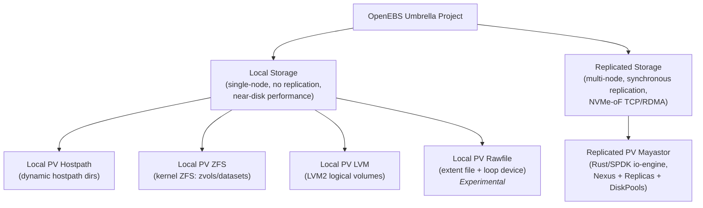
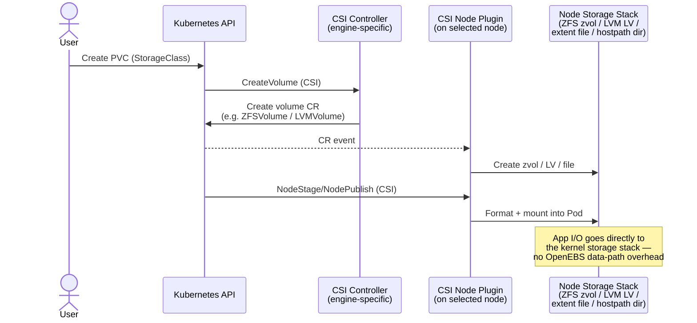
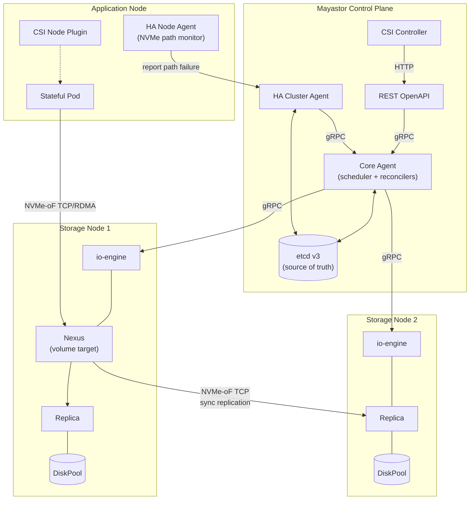
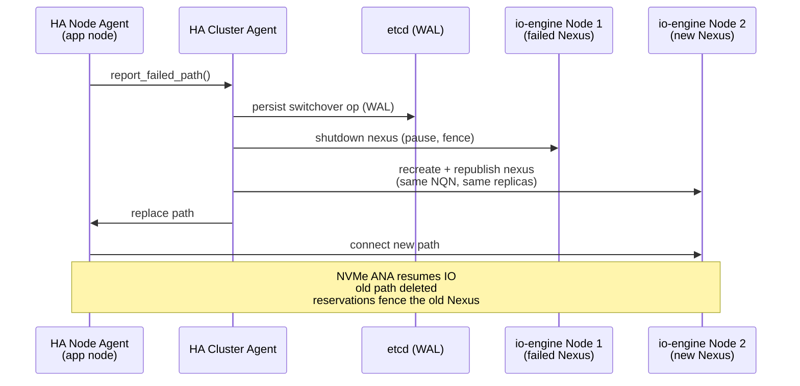

# General Technical Review - OpenEBS / Incubation

- **Project:** OpenEBS
- **Project Version:** v4.5.1
- **Website:** <https://openebs.io>
- **Date Updated:** 2026-08-07
- **Template Version:** v1.0
- **Description:** OpenEBS is an open-source Container Native Storage solution that turns storage available on Kubernetes worker nodes into Local or Replicated Kubernetes Persistent Volumes. It is an umbrella project of five storage engines: Local PV Hostpath, Local PV ZFS, Local PV LVM, Local PV Rawfile (Experimental) and Replicated PV Mayastor.

## Day 0 - Planning Phase

### Scope

- **Roadmap process:** The public [ROADMAP.md](https://github.com/openebs/openebs/blob/HEAD/ROADMAP.md) lists near-term and long-term items across all engines, tracked in the [GitHub Roadmap Project](https://github.com/orgs/openebs/projects/78). The [roadmap change process](https://github.com/openebs/community/blob/HEAD/ROADMAP.md#roadmap-change-process) is documented; maintainers curate the roadmap by prioritizing inputs from GitHub issues, Slack queries and domain-specific needs, evaluated against the project [scope](https://github.com/openebs/community/blob/develop/VISION.md#scope). Larger features follow the [OEP (OpenEBS Enhancement Proposal) process](https://github.com/openebs/openebs/blob/HEAD/designs/oep-process.md). The contributor-to-maintainer ladder is documented in [GOVERNANCE.md](https://github.com/openebs/community/blob/HEAD/GOVERNANCE.md).
- **Target personas:** Platform engineers/SREs operating Kubernetes clusters, DevOps teams deploying stateful workloads, and application developers consuming PersistentVolumes.
- **Primary use case:** Dynamic provisioning of persistent storage for Kubernetes stateful workloads from node-local storage.
  - **Local PV Hostpath:** dynamic hostpath volumes with node affinity; easy onboarding, dev/test and workloads with app-level replication.
  - **Local PV ZFS:** CSI provisioning on a ZFS stack, exposing ZFS features (snapshots, clones, compression, encryption, resize).
  - **Local PV LVM:** CSI provisioning on an LVM2 stack (snapshots, thin provisioning, resize).
  - **Local PV Rawfile (Experimental):** CSI provisioning of loop-device backed extent files with enforced size limits and per-volume filesystems.
  - **Replicated PV Mayastor:** synchronously replicated block storage over NVMe-oF (TCP/RDMA) for workloads requiring storage-level high availability.

- **Unsupported use cases:** Documented as out-of-scope in [VISION.md](https://github.com/openebs/community/blob/develop/VISION.md#scope): GUI/dashboards, vendor-specific proprietary integrations, vendor-specific auth/key management, own filesystem development, and updates to archived/legacy engines. ReadWriteMany is supported only with strict limitations (e.g. via NFS layering).
- **Target organizations:** Any organization running stateful workloads on Kubernetes — on-premises, cloud, hybrid or edge — including software manufacturers, platform engineering teams, telcos and financial services.
- **End user research:** Adoption feedback is gathered via [ADOPTERS.md](https://github.com/openebs/community/blob/develop/ADOPTERS.md) success stories and CNCF adopter interviews.

### Usability

- **Interaction:** Standard Kubernetes workflows — Helm install, StorageClasses, PVCs and CRs managed via `kubectl`. OpenEBS additionally provides a [kubectl plugin](https://openebs.io/docs/user-guides/kubectl-openebs).
- **UX/UI:** Declarative, Kubernetes-native; no graphical UI (explicitly out of scope). Observability via standard tooling (Prometheus, Grafana).
- **Integrations in production:** CSI (all engines except Hostpath, which uses the external-provisioner library pattern), Velero for backup/restore, Prometheus/Grafana for monitoring, and etcd (dedicated instance) for the Mayastor control plane. Documented at [integrations](https://github.com/openebs/community/blob/HEAD/README.md#integrations-with-other-projects).

### Design

- **Design principles:** Kubernetes-first, CSI-compliant, declarative reconciliation of desired state, microservices control planes, vendor-neutral and storage-media agnostic. Design docs: [openebs/designs](https://github.com/openebs/openebs/tree/HEAD/designs), [Mayastor design](https://github.com/openebs/mayastor/tree/HEAD/doc/design).
- **Architecture requirements:** Documented per engine: [OpenEBS](https://github.com/openebs/openebs/blob/HEAD/README.md), [Local PV Hostpath](https://github.com/openebs/dynamic-localpv-provisioner/blob/HEAD/README.md), [Local PV ZFS](https://github.com/openebs/zfs-localpv/blob/HEAD/README.md), [Local PV LVM](https://github.com/openebs/lvm-localpv/blob/HEAD/README.md), [Local PV Rawfile](https://github.com/openebs/rawfile-localpv/blob/HEAD/docs/architecture.md), [Mayastor](https://github.com/openebs/mayastor/blob/HEAD/README.md). PoC/dev/test can run with minimal footprints (e.g. file-backed pools for Mayastor); production requirements (hugepages, dedicated cores, NVMe) are in the [docs](https://openebs.io/docs).

  **Local PV engines (ZFS / LVM / Rawfile / Hostpath) — provisioning flow.** Each Local PV engine is a control plane only; there is no OpenEBS component in the data path. The CSI controller receives the provisioning request and records intent as a CR; the CSI node plugin on the selected node creates the backing entity (zvol/dataset, LV, extent file or hostpath directory) and mounts it for the workload:

  **Replicated PV Mayastor — high-level architecture.** A microservices control plane (K8s-independent, etcd-backed) manages Rust/SPDK io-engine instances on storage nodes. Each volume gets a Nexus (NVMe-oF target) that synchronously replicates writes to Replicas carved from DiskPools on multiple nodes:

  **Mayastor HA failover ("switchover").** On NVMe path failure the HA node agent reports to the HA cluster agent, which executes an etcd-WAL-backed switchover — shutting down the old Nexus, recreating it on a healthy node with the same NQN, and letting NVMe ANA transparently resume application I/O; NVMe reservations fence the old target ([HA design](https://github.com/openebs/mayastor/blob/HEAD/doc/design/ha-failover.md)):

- **Service dependencies:** Kubernetes API server and kubelet for all engines. Engine-specific node dependencies: ZFS (zfsutils) for Local PV ZFS, LVM2 for Local PV LVM, loop devices for Rawfile. Mayastor requires an etcd cluster (deployed by the Helm chart), the nvme-tcp kernel module and 2MiB hugepages on storage nodes.
- **IAM:** Uses Kubernetes RBAC/ServiceAccounts; components ship with scoped roles via Helm charts. Mayastor's REST API supports [mTLS](https://openebs.io/docs/main/user-guides/replicated-storage-user-guide/replicated-pv-mayastor/configuration/rs-security). Vendor-specific auth/key management is out of scope.
- **Sovereignty:** Fully self-hosted within the user's cluster; no data leaves the cluster. Anonymous usage analytics/call-home can be disabled.
- **Compliance:** No specific regulatory compliance certifications are claimed by the OSS project.
- **High availability:** Local PV engines are node-bound by design (no replication); HA is delegated to the application. Mayastor provides HA via synchronous n-way replication and automated target failover ("switchover") with NVMe reservations for fencing (see diagram above). Control-plane state is stored in etcd.
- **Resource requirements:** Local PV engines are lightweight control planes with no data-path overhead and no strict memory requirements. Mayastor io-engine requires 2MiB hugepages (2GiB by default) and dedicated CPU cores per storage node for its poll-mode SPDK data path.  
Requirements documented in the [Prerequisites](https://openebs.io/docs/quickstart-guide/prerequisites).
- **Storage requirements:** Consumes node-local block devices or directories: hostpath directories (Hostpath), ZFS pools (ZFS), LVM2 volume groups (LVM), extent files (Rawfile), and block devices via io_uring/PCIe organized into DiskPools (Mayastor). Mayastor control-plane configuration is persisted in etcd.
- **API design:**
  - Kubernetes-native APIs: StorageClasses plus CRDs — `ZFSVolume`/`ZFSSnapshot`, `LVMVolume`/`LVMSnapshot`, `DiskPool`, etc. All engines except Hostpath implement the CSI spec (Identity/Controller/Node services). Mayastor additionally exposes a [REST OpenAPI](https://github.com/openebs/mayastor/blob/HEAD/doc/design/public-api.md) and internal gRPC APIs defined in [protobuf](https://github.com/openebs/mayastor-control-plane/tree/HEAD/control-plane/grpc/proto/v1).
  - Defaults: Helm charts install with working defaults; StorageClasses are created out of the box. Additional configuration (pools, volume groups, replica counts) is via StorageClass parameters and CRs.
  - No changes to Kubernetes API server behavior; CRDs are versioned per Kubernetes conventions and follow deprecation rules. Breaking API changes are only made in major releases with documented migration steps.
- **Release process:** Documented per repo: [OpenEBS RELEASE.md](https://github.com/openebs/openebs/blob/HEAD/RELEASE.md) and per-engine RELEASE.md files. Unified umbrella releases with semver (major/minor/patch); patch releases for bug and security fixes.

### Installation

- **Install:** Single Helm chart: `helm install openebs openebs/openebs -n openebs --create-namespace` installs the umbrella with all engines (engines can be enabled/disabled via values). Documented at [installation](https://openebs.io/docs/quickstart-guide/installation).
- **Validation:** Verify pods are ready (`kubectl get pods -n openebs`), StorageClasses exist, then provision a test PVC/pod per the [quickstart guides](https://openebs.io/docs/quickstart-guide/deploy-a-test-application). All OpenEBS engine's pool/volume health can be inspected with the kubectl plugin.

### Security

- **Security self-assessment:** <https://tag-security.cncf.io/community/assessments/projects/openebs/self-assessment/> (completed as part of the Sandbox application).
- **Cloud native security tenets:** Components run with scoped RBAC and minimal defaults. Node components require elevated privileges inherent to storage provisioning (see threat modeling below). Hardening defaults (e.g. disabling analytics, tightening RBAC, enabling mTLS) is under user control via Helm values.
- **Security hygiene:** Security policy and reporting process in [SECURITY.md](https://github.com/openebs/community/blob/HEAD/SECURITY.md); 2FA enforced at GitHub org level; CODEOWNERS and branch protection on repositories; OpenSSF Best Practices passing badges for OpenEBS and each engine; license scanning via FOSSA; CLOMonitor tracking. Dependency scanning and container image scanning run in CI across repositories.
- **Feature risk evaluation:** Deprecated/legacy engines are removed from the product and moved to the [openebs-archive](https://github.com/openebs-archive) organization so unmaintained code does not present a risk to users. Experimental engines (Rawfile) are clearly labeled.
- **Threat modeling / least privilege:** CSI node plugins and the Hostpath helper pods require privileged access for mount/device operations on the host — the minimal privilege inherently required by node-local storage provisioning. Controllers run unprivileged with scoped RBAC. Mayastor io-engine requires hugepages and device access on designated storage nodes only.
- **Certificate rotation:** Internal communication is within-cluster gRPC/REST. mTLS and certificate rotation for internal endpoints are implemented for Mayastor API Rest; API access is protected by Kubernetes network boundaries.
- **Supply chain:** Source hosted in the OpenEBS's CNCF GitHub enterprise org; builds via GitHub Actions; FOSSA license compliance; pinned, reproducible Nix-based build environments for the Rust/SPDK components. Publication of SBOMs are a roadmap item.

## Day 1 - Installation and Deployment Phase

### Project Installation and Configuration

- Helm-based installation of the umbrella chart (see Installation above). Configuration via Helm values (enable/disable engines, resource settings) and per-engine StorageClass parameters. Node preparation where applicable: ZFS pools, LVM volume groups, hugepages/nvme-tcp module for Mayastor. Documented in the [prerequisites](https://openebs.io/docs/quickstart-guide/prerequisites) and per-engine quickstarts.

### Project Enablement and Rollback

- **Enable/disable:** Installed/uninstalled via Helm in its own namespace with no control-plane downtime for the cluster; individual engines toggled via Helm values. Existing published volumes on nodes continue to serve I/O during control-plane component restarts (control planes are not in the data path; Mayastor's control plane participates only in reconfiguration events).
- **Default behavior changes:** No changes to cluster default behavior; OpenEBS adds StorageClasses and CRDs. It does not alter the default StorageClass unless configured to.
- **Testing of enablement/disablement:** Install/uninstall paths are exercised in per-repo CI (GitHub Actions) and e2e tests.
- **Resource cleanup:** Uninstall removes deployments; volume resources are cleaned per PV reclaim policy. CRDs are retained by default on uninstall to protect data, with documented manual [cleanup steps](https://openebs.io/docs/user-guides/uninstall).

### Rollout, Upgrade and Rollback Planning

- **Kubernetes compatibility:** Engines support Kubernetes v1.23+ with published compatibility matrices (e.g. [Hostpath matrix](https://github.com/openebs/dynamic-localpv-provisioner#kubernetes-compatibility-matrix)); compatibility is maintained against current upstream Kubernetes releases on an ongoing basis.
- **Upgrades:** Via Helm; documented at [upgrades](https://openebs.io/docs/user-guides/upgrades). OpenEBS provides an `upgrade` sub-command in its kubectl plugin performing control-plane upgrade and rolling data-plane upgrades. Local PV volume data is unaffected by control-plane upgrades.
- **Rollback:** Downgrades are not formally tested and users are advised not to perform any rollbacks.
- **Failure modes:** A failed rollout may leave the previous provisioner unavailable for *new* volumes; already-provisioned local volumes continue to serve I/O since there is no OpenEBS component in the local data path. For Mayastor, rolling upgrades move volume targets before restarting an io-engine, relying on replica redundancy; volumes with insufficient healthy replicas would degrade.
- **Metrics informing rollback:** Rollbacks are not supported, so there are no metrics for it.
- **Upgrade testing:** Upgrade paths are tested in CI/e2e for each release; upgrade->downgrade->upgrade paths are not part of the formal test matrix.
- **Deprecations:** Communicated via release notes, CHANGELOGs and the roadmap; deprecated engines are moved to the openebs-archive organization per the documented [archive process](https://github.com/openebs/community/blob/develop/VISION.md#archive-organization).
- **Alpha/beta capabilities:** Experimental features are gated per-engine and clearly labeled (e.g. Local PV Rawfile is Beta/Experimental and excluded from production support statements); users opt in explicitly via Helm values/StorageClass parameters.