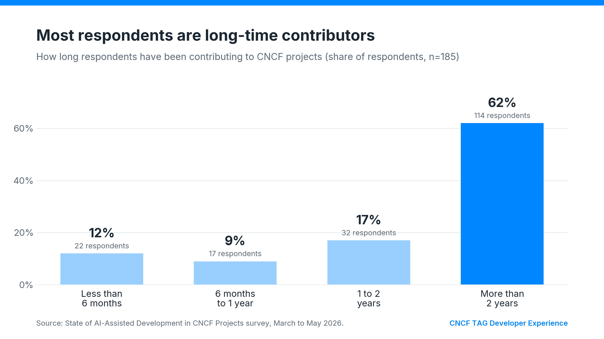
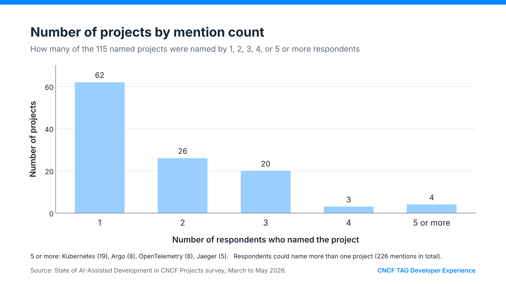
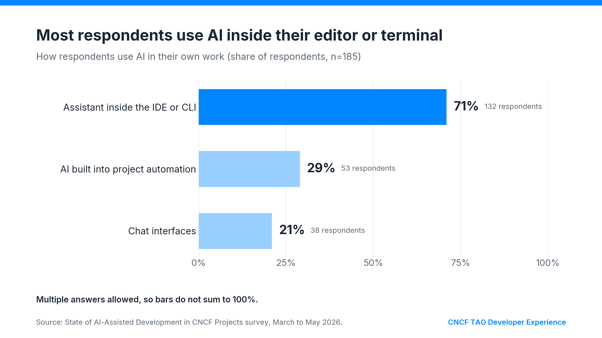
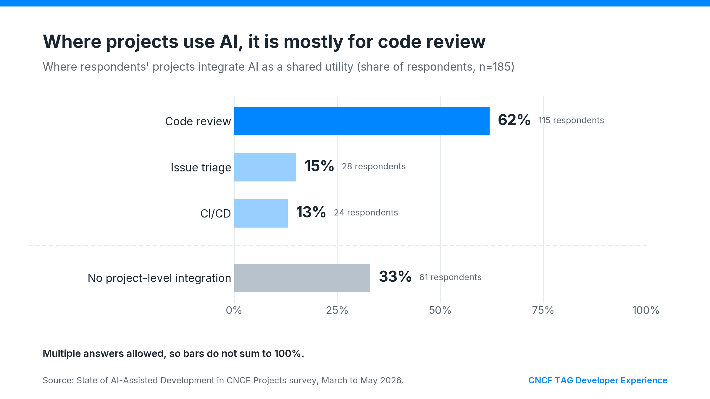
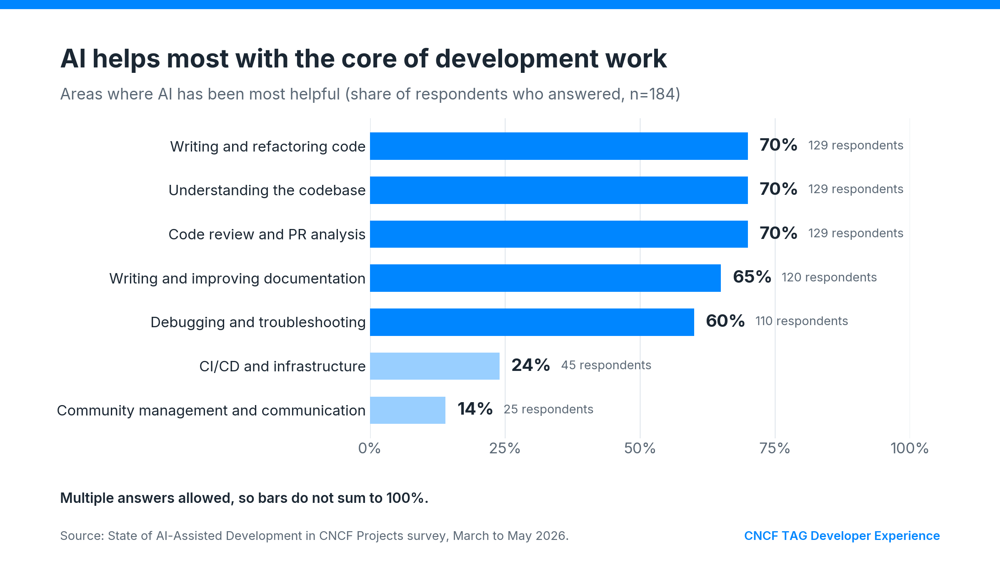
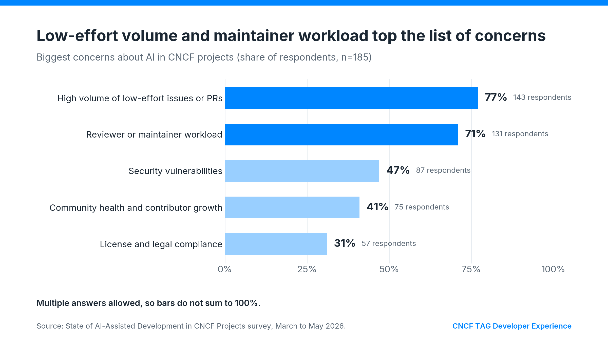
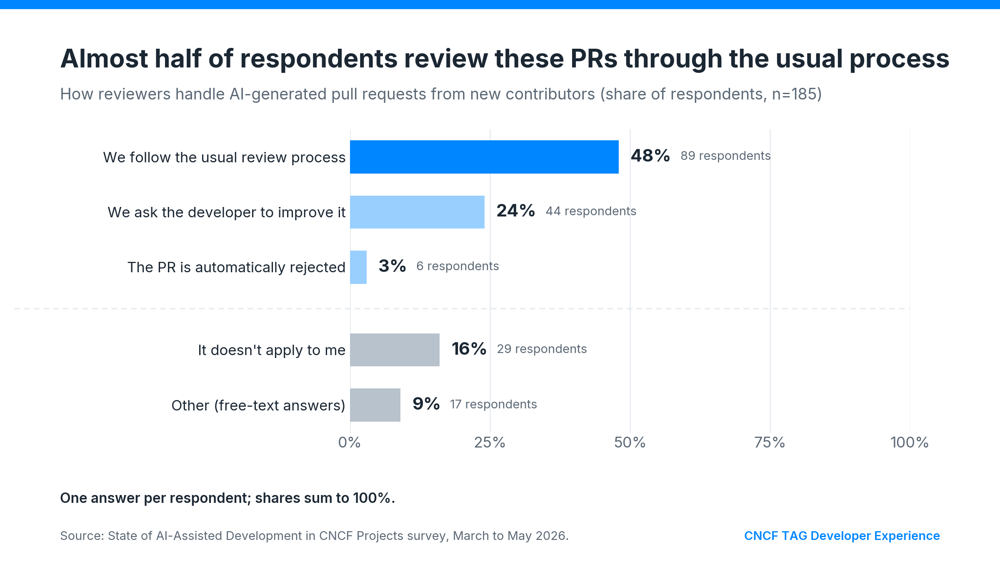
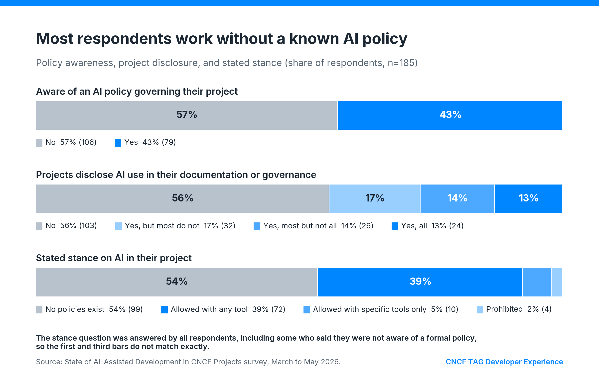
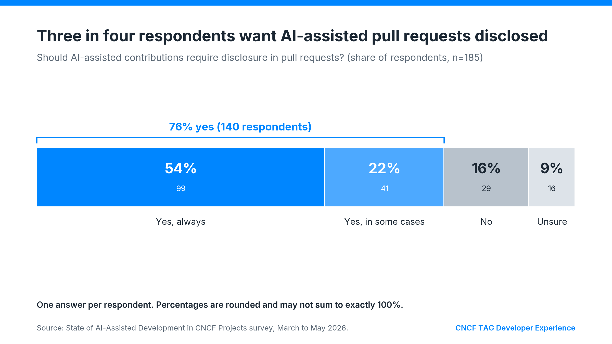

# AI-Assisted Development in CNCF Projects: Findings from Maintainers

**Authors:** Graziano Casto, Sonali Srivastava, Hélia Barroso, Alessandro Pomponio

## Executive Summary

It took less than a year for AI assistance to go from something only a handful of maintainers experimented with to a tool most CNCF contributors use. This whitepaper collates experiences shared by maintainers across the CNCF landscape to help projects get up to speed and avoid repeating common mistakes.

The data in this whitepaper was collected by CNCF TAG Developer Experience between March and September 2026 through a survey and a set of deep-dive questions with maintainers from projects such as OPA, OpenTelemetry, OpenTofu, kcp, Trickster, wasmCloud, Cilium, Fluent, Kairos, HAMi, and OpenFeature. The survey had 185 responses from people in 115 projects, and 18 people answered the deep-dive questions in live interviews or written questionnaires.

The standout observation from the data we collected is that AI has made changes much cheaper to produce than to verify. Maintainers now have to review more change requests and also work out whether the account behind each one understands the change.

This whitepaper is purely descriptive. It reports what maintainers do and what they say, including the places where they disagree, and it does not issue recommendations on behalf of the TAG or propose a CNCF policy.

### **Key findings at a glance**

* **Low-effort contributions are the top concern.** 77% of respondents (143 of 185\) name the high volume of low-effort issues or pull requests as a concern, closely followed by increased reviewer or maintainer workload at 71% (131).
* **Individual use is widespread but project-level use is narrow.** 71% of respondents (132) use an AI assistant inside their editor or command line, while 33% (61) say their project does not integrate AI into shared workflows at all. Where projects do integrate it, code review is by far the most common place.
* **Governance lags behind use.** 57% of respondents (106) are not aware of any AI policy that applies to their project, and 56% (103) say their projects do not mention AI use in their documentation or governance.
* **Most respondents want disclosure.** 76% of respondents (140) think AI-assisted contributions should be disclosed in pull requests, always (99) or in some cases (41).
* **Where AI is proving effective.** Maintainers report AI being particularly helpful for triaging issues, understanding unfamiliar code, and first-pass reviews. Large refactors, debugging, and security testing benefit most from AI when tests and conformance suites can act as guardrails.
* **Contributors are still verified manually.** Maintainers assess whether contributors understand and can support their changes through review discussions, probing questions, and other manual checks. None reported having a reliable automated way to distinguish human contributors from automated accounts.
* **The contributor ladder is under pressure.** Maintainers agree that attitude and intent to own the code matter more than how contributors generate code, but several report that fewer people want to become maintainers as human interaction in reviews declines.

## Part I. Context

### Chapter 1\. Introduction

Not long ago, most conversations about AI in open source were about whether it would be useful. Today the question in most CNCF projects is how to deal with it. Maintainers use AI assistants to read unfamiliar code, write tests, and review pull requests, while contributors use them to find bugs and propose fixes. Projects of every size report a steady stream of issues, pull requests, and security reports that were produced quickly and with little human attention, and that take a lot of maintainer time to handle.

Each project has been responding on its own. Some have written a policy, some have added a line to their contributing guide or an `AGENTS.md` file, and many have done nothing formal yet. When we asked maintainers what they wanted from this initiative, a common answer was simply to know what other projects are doing.

This whitepaper is the final deliverable of the *State of AI-Assisted Development in CNCF Projects* initiative run by CNCF TAG Developer Experience. The initiative's charter describes the goal as helping CNCF projects move from ad-hoc experimentation to confident adoption. The survey results were published earlier in the [initiative's repository](https://github.com/cncf/toc/tree/main/tags/tag-developer-experience/initiatives/state-of-ai-assisted-development), and this whitepaper builds on them with a round of maintainer interviews.

#### Scope

The whitepaper covers how AI is used in the real development work of CNCF projects: in local development environments, CI pipelines, code review, issue triage, documentation, and community operations. It covers both how maintainers use AI and how they handle contributions from others who use it.

Topics such as benchmarking of open and commercial products are deliberately out of scope. Tools are mentioned by name only where the data requires it, and no evaluation or recommendation is implied.

#### A descriptive guide

This whitepaper reports practices that projects already use. It doesn’t tell you which ones to adopt. For each practice, we name the project that uses it or the maintainer who described it to us. When maintainers disagree, we present each position and the reasons behind it, and leave the decision to you.

There are two reasons for this choice. First, the tools change faster than any rule. Several interviewees told us that a fixed AI policy starts to age within weeks, and that what worked in January no longer matched how people worked in June. Second, CNCF projects differ a lot. A project with five full-time maintainers faces very different pressures from a volunteer project with a handful of occasional reviewers, or from a large project that attracts hundreds of new contributors through mentorship programs. A practice that protects one of them may be unnecessary overhead for another.

Maintainers can use this guide to see which problems other projects have already faced, what they tried, and how it worked.

##### Terms used in this guide

A few terms appear throughout the guide, and we use them in a specific way.

* **AI-assisted** work is work where a person directs the tool, reviews the output, and takes ownership of the result.
* **AI-generated** work is output submitted with little or no human review.
* An **automated account** is a GitHub account that submits issues or pull requests with no person in the loop.
* A **low-effort contribution** is one whose review cost is out of proportion to its value, whatever tool produced it. Low-effort contributions existed long before AI, and several maintainers pointed this out.

#### How to read this guide

*Part II* describes the current state of practice: how AI shows up in CNCF projects, where maintainers see value, and where the cost lands. *Part III* is the core of the guide. Each of its chapters covers one area of maintainer work and follows the same structure: the situation maintainers describe, the practices they have adopted, the trade-offs they report, and the points where they disagree. *Part IV* closes with open questions the community raised.

Maintainers looking for something specific can go straight to the relevant chapter. *Chapter 8* covers incoming AI-assisted contributions, *Chapter 10* covers security and legal questions, and *Chapter 11* covers AI policies.

### Chapter 2\. How this whitepaper was built

The whitepaper combines a quantitative survey with qualitative interviews. The survey tells us how common certain experiences and opinions are among the people who answered. The interviews tell us why maintainers make the choices they make and what those choices look like in practice.

#### Survey

The survey was open from March 25 to May 18, 2026, and asked 15 questions about AI use, project integration, governance, disclosure, and concerns. It received 185 responses. Respondents could name more than one project, and after normalizing spelling and merging sub-projects into their parent (for example, Argo CD and Argo Rollouts into Argo), the answers cover 115 distinct CNCF projects.

Most respondents are experienced contributors. 62% (114) have been contributing to CNCF projects for more than two years, 17% (32) for one to two years, 9% (17) for six months to a year, and 12% (22) for less than six months. Most describe their role as code-centric, and a smaller group works mainly on documentation, release, or community tasks.

*FIGURE 2.1 Respondent tenure.*

The anonymized raw answers, the survey results report, and the original charts are published in the initiative folder of the [`cncf/toc`](https://github.com/cncf/toc/tree/main/tags/tag-developer-experience/initiatives/state-of-ai-assisted-development/assets/survey-results) repository.

#### Interviews

Between July and September 2026 we reached out to 18 maintainers with additional questions about current AI use, concrete wins, low-effort contributions, review practices, the path to maintainership, unsolved problems, policies, and a possible CNCF baseline.

The interviews cover projects from Sandbox to Graduated. We reviewed the material by reading each input against the question guide, tagging recurring themes, and grouping them into the chapters of *Part III*. When a theme appeared in only one project, we say so in the text.

Quotes from live interviews were transcribed automatically and lightly edited to remove false starts and filler words, without changing their meaning. Interviewees are named with their project unless they asked not to be named, and each named source was offered the chance to review the passages that cite them. Quotes from the survey's free-text field are anonymous.

#### Who we reached, and how

The views in this whitepaper depend on who took part, so this section explains how we recruited participants.

Survey respondents and interview participants were recruited mainly through the existing networks of initiative members and through snowball sampling, where interviewed participants referred to additional contacts. We chose this approach to reach maintainers quickly within a short research period. As a result, the sample may reflect characteristics of those networks, **so** keep this in mind when you assess the findings.

**Clustering by project.** Respondents could name several projects, which gives 226 project mentions in total. 53 projects were named by two or more respondents, and together they account for 73% of all mentions (164 of 226). 27 projects were named by three or more respondents. Kubernetes (19), Argo (8), OpenTelemetry (8), and Jaeger (5) lead the list, but the clustering is spread across many projects. The other 62 projects appear only once. Several answers from the same project can reflect one team's shared context rather than independent views, and projects where the initiative members had contacts are overrepresented.

*FIGURE 2.2 Projects by number of respondents.*

**Clustering in the interviews.** Some projects are represented by more than one voice. kcp, for example, appears through two interviewees, and several participants were referred to us by people we had already interviewed. Findings that rest mainly on one project's voices are flagged in the chapters that follow.

#### Other limitations

The survey asked respondents to list tools in a free-text format. To analyze the results, we grouped responses into tool families based on keywords. The survey also did not capture project maturity, so we cannot make direct comparisons across CNCF Sandbox, Incubating, and Graduated projects. In addition, the interviews provide insight into maintainers’ experiences and decision-making, but they are not designed to measure how common specific practices are.

As a result, the percentages reported in this whitepaper apply only to the individuals who responded to the survey. They should not be interpreted as representative of all CNCF projects or contributors. Similarly, when this guide describes a practice, it shows that the practice exists and how maintainers approach it, not how common it is. Future research with a broader and more systematic recruitment strategy, such as outreach through project maintainer mailing lists rather than personal networks, could help reduce these sources of bias and improve representativeness.

## Part II. The state of practice

### Chapter 3\. How AI shows up in CNCF projects

Most people who answered the survey use AI in their own work, usually inside their editor or terminal rather than in a separate chat window. Far fewer say their project uses AI as a shared utility, and when it does, it is usually for code review. The interviews show that behind these averages there is a wide range of practices, from maintainers who write almost no code by hand to projects that ban AI-generated code in part of their codebase.

#### Individual use and project-level use

We asked the respondents how they use AI in their own work and where their project uses it as a shared tool. The two figures below show the answers side by side.

*FIGURE 3.1 How respondents use AI in their own work.*

*FIGURE 3.2 Where projects integrate AI as a shared utility.*

Together, the two figures show a gap. Individual use is widespread, and the in-editor assistant has become the default way people work with AI. Project-level use is much narrower: code review is the only shared integration that a majority of respondents report, and a third say their project has no shared AI integration at all. In most projects, AI is something individual contributors and maintainers bring with them, and the project as a whole has not yet decided what to do about it.

#### Tools, briefly

The tool question was free text. After normalizing the answers into tool families, the most common were Claude (named by 60% of the 171 people who answered the question) and GitHub Copilot (49%), followed at a distance by ChatGPT, Gemini, OpenAI Codex, and Cursor, each named by around one respondent in nine. The more interesting finding is that people rarely stick to one tool: 58% of those who answered (100 of 171\) named two or more tool families. Maintainers in the interviews described the same pattern, choosing tools depending on task, cost, or region.

#### A wide spread of practice

The survey categories hide how different daily practice can be from one maintainer to the next. The interviews covered, among others, the following situations.

**AI writes most of the code.** Kairos is a niche project at the operating system level that receives very few external contributions, and internally, *Mauro Morales* told us, all maintainers use AI heavily and nearly all code is now produced with it, with the exception of low-level firmware work where the models still struggle. *Mangirdas Judeikis* of kcp estimated that about 95% of his own code has been AI-generated since December 2025\. A maintainer of kai-scheduler put the share at 80 to 90% for both their own code and incoming contributions, including issue and pull request descriptions. Other maintainers told us that nearly all incoming contributions to their projects are AI-assisted and that a large share of these come from what they called "unfiltered" AI flows, where maintainer comments are fed back to the model and the answers are posted almost unchanged.

**AI mainly supports review and triage.** At OpenFeature, a maintainer uses Copilot for their own work and runs agentic workflows to triage issues, while reporting little low-quality AI output in incoming contributions. At HAMi, a maintainer said they use AI to generate tests and, above all, to support their own code reviews. *Joshua Jones* of OpenFGA described that in their workflow AI agents do a first pass on every pull request but where the team has not yet found a good way to use AI for writing its own code.

**A maintainer who stopped.** *Christoph Mewes* started using AI for code at the beginning of 2026 and stopped in June. His written answer describes how quickly his habits changed:

> *Once Claude made the first few PRs, I stopped reading its output and just began to blindly trust the LLM's output and submit PRs with little testing or oversight. Likewise I stopped reading code and so I also stopped learning new things. \- Christoph Mewes*

After going back to reading and writing code by hand, he reported that both his mood and his output improved. His experience is one account, and we include it because it describes a risk that other interviewees mentioned in milder terms: that delegating the work also means delegating the learning.

**AI restricted by design.** OpenTofu permits AI-generated code only in some repositories and only for maintainers, and never for community contributors. The reason is legal rather than technical, and it is covered in *Chapter 11*.

These differences matter for everything that follows. A practice that works well in a project where maintainers generate most of their code with AI may make little sense in a project that restricts AI for legal reasons, and the reverse is also true.

### Chapter 4\. Where maintainers report value

Maintainers who report successful use of AI describe gains that are concrete and, in some cases, substantial. The benefits are most consistent when something outside the model can validate its work, such as a test suite, and when the task is focused on reading and understanding rather than decision-making.

*FIGURE 4.1 Areas where AI has been most helpful.*

The survey shows that respondents see value across the core of development work, with CI/CD and community tasks well behind. The interviews add detail on where that value comes from.

#### Generation with a guardrail

The clearest success stories share one feature: there is an objective way to verify the model's output. The Open Policy Agent (OPA) project used AI to implement built-in functions in alternative runtimes for Swift and Java. The project’s existing conformance test suite made this easier. An OPA project maintainer explained what made it work:

> *We have a conformance test suite... the Rego language has a series of test examples which are written in Rego which should produce expected results, and the intermediate representation implementations are tested against this to ensure their conformance. That, I think, is probably the main technique that has enabled this project to be successful. \-* OPA project maintainer

Kairos tells a similar story at a different scale. Its test matrix runs 400 to 500 tests across Linux distributions and features, and *Mauro Morales* described AI as effective at working through it. In both cases the tests carry the judgment about correctness, and the model does the typing.

#### Large refactors and migrations

Large refactors and migrations are another area where maintainers see clear gains. *Pablo Baeyens* noted that AI has made prototyping and large refactors easier across the roughly 260 components of the OpenTelemetry Collector. OPA maintainers used AI to assist with the migration of a WebAssembly evaluation code. Another maintainer listed major overhauls, refactors, and migrations as the main win. Pablo also pointed out where the gain stops:

> *It has sped up some parts of the discussion because it makes prototyping easier. But ultimately a lot of the blockers are not necessarily on the code writing. It's more about getting consensus or agreement from a group of people. \- Pablo Baeyens*

#### Understanding unfamiliar code

Many maintainers use AI to get up to speed on parts of a project they don't know well. *Mauro Morales* described how it helps with parts of Kairos that nobody has touched for a while:

> *You touch this once and you forget about it, and then two years later you want to touch something and you're like, what's happening there? AI has done a lot for us there, because it can read the documentation, it can read the tests, and in a matter of minutes you can have the answer to something that would take you days or weeks. \- Mauro Morales*

The same benefit applies to newcomers. *Bailey Hayes* of wasmCloud, who contributes to more than 30 open source projects, finds AI helpful for learning a new project's architecture before a first contribution. A maintainer of HAMi said that AI significantly lowers the barrier to understanding a project.

#### Debugging and performance

Several maintainers named debugging as the biggest win, especially for problems that require going through large amounts of logs or data. At kcp, *Mangirdas Judeikis* described a memory leak that only became visible after objects were created and deleted around 10,000 times. By comparing heap and memory dumps across runs, the model found almost every leak, work he estimated would take people weeks. Another kcp maintainer uses AI to trace errors through large log files for the same reason.

#### First-pass review and community operations

AI-based review tools and triage workflows came up often enough that they have their own chapter (*Chapter 7*). In short, several projects use AI to give contributors early feedback before a maintainer looks at a pull request, and some use it to triage issues, label pull requests, or summarize community meetings.

#### Security testing

The kcp project found a more unconventional use for AI. The team built an isolated local environment that outputs a low-privilege kubeconfig and handed it to a model with instructions to escalate privileges and break tenant isolation. The setup is now part of the repository as a pen-test scenario. A maintainer explained why it worked:

*That was a big win, because LLMs don't stop like a human pen tester. They keep going until they find a way to do what they were tasked to do, given that they have enough tokens.*

#### A wider pool of contributors

*James Ranson* of Trickster noted that some contributors rely on AI to help navigate language barriers, using it to translate maintainer feedback, make changes, and respond to reviewers.  In his view this has expanded the pool of people who can contribute to the project. The same effect has a cost for reviewers, which we return to in *Chapter 10*.

#### The limits maintainers keep hitting

While the examples above show clear benefits, maintainers were also candid about AI's current limitations.

* **Low-level and specialized code.** At Kairos, models fail on firmware and low-level system tasks. *Mauro Morales* described models that "*come back super confident it's done and it doesn't even compile*."
* **Correct doesn't always mean optimal.** *Mauro* also noted that a model will solve a problem without telling you whether the solution is the most efficient one, which matters in a project where every bit of memory and disk space counts.
* **Missing edge cases.** A maintainer observed that AI-generated code often looks correct but is wrong in the details, because edge cases the author would normally reason about are simply not considered.
* **More code than the problem needs.** Some maintainers described AI that tends to "*over complicate many things, write more code than it really needs and overwriting everything by default, so it requires a lot of baby sitting*." Another maintainer named the same issue, making changes more minimal and maintainable, as his biggest unsolved problem.
* **Inconsistent judgment.** Mauro Morales and other survey respondents noted that agent harnesses differ in how critical they are: given the same request, one may push back with “that is not the best idea”, while another implements it without comment, and which one does better depends on the task.

### Chapter 5\. Where the cost lands

The concerns respondents raised most often were about the growing maintenance burden created by an increasing volume of contributions. Much of that burden falls on the maintainers responsible for reviewing, triaging, and responding to them. The interviews show what that burden looks like day to day, and why it is larger than the survey alone suggests.

*FIGURE 5.1 Biggest concerns about AI in CNCF projects.*

#### Volume and its shape

The first cost is time. *Bailey Hayes* described what happened to triage at wasmCloud once AI-generated issues and pull requests started arriving:

> *It takes a lot of time to just figure out what they were trying to do, and the approaches they took, if that was even valid. So I would say that our time triaging has quadrupled at least. \- Bailey Hayes*

OpenTofu receives a low-effort AI-generated pull request about every other day, according to *James Humphries*, which the team of five full-time maintainers can still keep up with. *Pablo Baeyens* described one contributor who opened tens of pull requests to the OpenTelemetry Collector in a couple of weeks, of which only one was merged.

We asked interviewees to estimate what share of recent AI-assisted contributions were low-effort. The answers ranged widely. A maintainer estimated about 20% for HAMi, where most AI-assisted pull requests are useful. A maintainer of kai-scheduler put it at about half. Other maintainers estimated 60 to 70%. *Christoph Mewes* guessed about 90%, and a Cilium maintainer answered 95%. Kairos, a project with few external contributors, reported almost none. The spread is a finding in itself: how much a project suffers depends heavily on its visibility, its position in mentorship programs and contribution events, and the kind of contributors it attracts.

#### What low-effort contributions look like

Maintainers in different projects described the same signals independently of each other.

* **Descriptions out of proportion to the change.** An OPA project maintainer pointed to very long, overly descriptive pull request descriptions for small and uninteresting changes. Another maintainer described AI-created issues that are "*over verbose to the point that they are unreadable.*"
* **Superficial contributions.** *Christoph Mewes* described blind dependency bumps and fixes produced by asking a model to find and fix security issues, many of which were wrong.
* **Outdated patterns.** On the OPA project, deprecated imports and heavy use of generic functions in Rego code are a common sign.
* **AI-written replies to review comments.** Several maintainers described feedback being pasted into a model and the model's answer being posted back.
* **Abandonment.** Contributors disappear after submitting, and pull requests sit with unanswered review comments until they are closed.
* **Contributions used for advertising.** A maintainer of OpenFeature saw a pull request that contained advertisements.

#### The regeneration loop

One pattern turns a single pull request into a heavy cost. A maintainer leaves feedback on part of a change, the contributor passes it to the model, and the model rewrites the whole change instead of adjusting that part, so the entire pull request has to be reviewed again. An OPA project maintainer described where this leads:

*Another failure mode is like I described where PRs are re-based and then made challenging to review and maintainers provide feedback again and again and again, and then they either give up or kind of lose momentum. \-* OPA project maintainer

*Joshua Jones* of OpenFGA described spending a week or more on a single pull request with a contributor who kept resubmitting AI output that did not address the feedback, until he recommended closing it and having a maintainer make the change instead. He also described what that effort feels like:

> *It is demoralizing to some degree as a maintainer, because you feel like you get all these people that don't really care, they're not putting effort into it, but you are. \- Joshua Jones*

He added that even feeling demoralizing, as maintainers are getting through it and trying to find ways to cope, since AI contributions are not going to go away.

#### Documentation is harder to review than code

Code has compilers, linters, and tests. Prose has far fewer guardrails. An OPA project maintainer, who works a lot on the OPA documentation, explained why AI-written documentation is deceptive:

*The scope of what you can write in English is very broad. The guardrails around valid English are much wider. You can be much more creative or inconsistent with natural language than you can be with code or configuration. \-* OPA project maintainer

Such changes often look fine at a glance and only reveal problems in style, examples, or formatting after several rounds of review. This observation comes mainly from OPA, although a survey respondent also described documentation changes as the worst case, because comments are piped back to the model and the review goes "*round and round.*"

#### Security reports

Security reports carry a special cost, because each one has to be taken seriously. *Pablo Baeyens* described an influx of security reports to the OpenTelemetry Collector: many were nonsensical, and many others described real behavior that was not a meaningful security risk for users, such as availability issues that depend on how users configure the Collector.

A Cilium maintainer described an early report on a complex race condition that turned out to be entirely hallucinated:

*I spent perhaps 30-60 minutes digging through the relevant code, refreshing my understanding in the area and developing an understanding of the operations, only to find that the proposed solution moved code around without making any functional change to the ordering of the execution. \- Cilium maintainer*

*Chapter 10* covers how projects are responding.

#### The newcomer path is wearing down

Some of the tools that projects built to welcome newcomers are being worn down. At wasmCloud, bot accounts regularly ask to be assigned to issues labeled "good first issue", and *Bailey Hayes* said this has discouraged the team from creating those issues at all. Labels meant to help people take their first step now attract automated accounts instead.

#### The human cost

For small teams, the main damage is to motivation rather than capacity. A maintainer of  k8up put it clearly:

> *We only have a handful of volunteer maintainers, who get easily overwhelmed by many issues/PRs and frustrated with even a small number of low-effort ones. So it's been primarily a team motivation issue, not so much an actual denial-of-service.- k8up maintainer*

Maintainers also described the social side of closing pull requests. A maintainer of kcp reported hostile reactions to rejections, although less often than at first. *Bailey Hayes* described the fear of discouraging a genuine newcomer every time the team closes a low-effort pull request.

#### What the survey does not show

The survey offered a hint that the problem is bigger than it looks. When we asked how reviewers handle pull requests from new contributors that appear to be AI-generated, the most common answer was that they follow the usual review process.

*FIGURE 5.2 How reviewers handle AI-generated pull requests from new contributors.*

The interviews suggest that "the usual process" now hides a large added cost. Several interviewees told us their review standards had not changed, and in the same conversation described extra rounds of review, profile checks, and time spent working out whether a real person was behind a change. The process is the same on paper, but it takes much more time and effort than it used to.

## Part III. Practices reported by maintainers

Each chapter in this part covers one area of maintainer work and follows the same structure: the situation maintainers describe, the practices they have adopted, the trade-offs they report, and the points where they disagree. Everything is presented as maintainers described it, as examples of what projects do and not as recommendations.

### Chapter 6\. Contributing with AI in your own maintainer work

#### The situation

Many CNCF maintainers now write a large share of their own code with AI, and several told us they review AI output from other contributors with the same tools they use for their own work. The maintainers who described the practices had put explicit guardrails in place to keep themselves in control of the result.

#### Practices maintainers described

**Planning before generating.** *Eric Schabell* of Fluent always starts with a planning step. He  asks the assistant to explain what it intends to do before it changes anything, and treats it as a capable assistant that still needs direction:

*I always start with planning, always, even for simple \[things\], just because I want it to go through and explain it and show me before \[it\] does anything. You're basically treating this as a junior developer... It does take away a lot of the plumbing work. \- Eric Schabell*

**Keeping the human parts human.** *Eric* reviews every changed line himself and handles all git operations, rebasing, and commit messages by hand. His reason is accountability:

*The reason I do that is because my name's on this commit. I want to see everything that is changing. \- Eric Schabell*

**Using more than one reviewer.** *Eric* also uses several AI tools rather than one, including a different assistant in CI, because each catches things the others miss. He compared it to having another layer of developers look at the code. A maintainer of OpenFeature described a similar habit, using an agent to act as a rubber duck while they work:

*Now I am writing this form while I have an agent doing some rubber-ducking for a bug fix for potential edge cases that I might have forgotten during the implementation.*

**Letting tests carry the judgment.** As described in *Chapter 4*, maintainers of the OPA project, and Kairos lean on conformance suites and large test matrices so that the model's output is checked by something other than the model. Maintainers without that kind of tooling reported more trouble. *Joshua Jones* of OpenFGA told us that his team, which works on a security-sensitive project, still writes much of its code by hand, because larger AI-generated changes tended to go off track even under a disciplined, spec-driven workflow.

**Making AI activity visible.** *Mangirdas Judeikis* runs his own bot for pull request reviews and small fixes under a name that is clearly linked to his personal account, so that nobody has to guess who is behind it. Kairos maintainers use dedicated agents with separate accounts for AI review and many other tasks, for the same reason.

**Choosing models by task and cost.** *Mangirdas* switches between several model providers depending on the task, looking for the cheapest option that still gives high quality. The survey data on tools suggests this is common, since most respondents name more than one tool family.

**Encoding your own experience.** A maintainer of HAMi captured their own review experience in the instructions of their coding assistant, so that it reviews pull requests the way they would. Another maintainer described using AI to build a more structured review process that shortened the time it takes them to give feedback, and noted that this now includes reviewing their own AI-generated pull requests, not only those from other contributors.

#### Trade-offs maintainers reported

**Less learning.** A maintainer of kcp uses AI to trace errors through logs, and pointed out what that costs:

*By doing this tracing myself in the past, I got to know the code base better, and that's the problem that I see with using AI for this, because you are maybe getting to a goal faster, but you're missing out on everything in between that you're learning about the code base.*

**Prompt bloat.** *Mauro Morales* described prompts that grow to thousands of tokens because models do not internalize a project's best practices unless they are spelled out every time. This makes AI use less efficient and harder to keep consistent.

**Disengagement.** *Christoph Mewes*, whose experience is described in *Chapter 3*, named his biggest unsolved problem as staying engaged when he hands over control to an AI. While he described the issue most strongly, similar concerns surfaced in several other interviews.

#### Where maintainers disagree

Maintainers disagree about what AI use means for the craft of programming itself. *Eric Schabell* sees AI tools as a natural step in the evolution of developer tooling, much like the move to IDEs, and sees no reason to treat AI-assisted work differently. A maintainer of OpenFeature made the same comparison with code completion. By contrast, other maintainers worried that AI could undermine the craft of coding. He found that the more he relied on it, the less he felt he was improving as a developer. Most interviewees sit between these positions: they use AI heavily and also keep deliberate habits, like planning, reviewing every line, or handling commits by hand, to make sure they still understand what they ship.

### Chapter 7\. Bringing AI into project automation

#### The situation

When respondents’ projects use AI as a shared utility, they use it mostly for review, and to a lesser degree for triage and CI (*Figure 3.2*). The maintainers who have done this successfully describe a similar path: a noisy start, a period of tuning, and a stable setup where AI handles the early, repetitive part of the work while people keep the final say.

#### Practices maintainers described

**A first pass on every pull request.** *Joshua Jones* of OpenFGA explained their project runs several AI review agents on each pull request as an initial step. Contributors receive early feedback and can address minor issues before a maintainer begins their review. In some cases, the tools also uncover problems that human reviewers might otherwise miss.. He emphasized that AI does not reduce the depth or rigor of human review, as maintainers still perform a thorough evaluation. The primary benefit comes by eliminating many rounds of small back-and-forth..

The rollout took time:

*It was kind of negative at first, because there were just a lot of false findings, or just things that weren't really important, and it would just make a mess of the PR and put lots of comments on there. But it's gotten significantly better as we've increased our understanding of how to use the tool and configure the tool. \- Joshua Jones*

**A reviewer that knows the project.** A maintainer of HAMi went a step further and captured his own review experience in the instructions of the assistant he uses for reviews:

*By capturing my review experience in Codex, AI can significantly improve the efficiency of my code reviews, especially when community contributors submit PRs with a large number of changes.*

**Automated triage.** An OpenFeature maintainer described using agentic workflows to help triage project issues. Similarly, a maintainer of k8up shared that they have been experimenting with AI to identify and close redundant issues and pull requests, including requests for features that already exist.

**Knowing who is waiting on whom.** The OpenTelemetry project built [tooling](https://github.com/open-telemetry/shared-workflows/tree/main/pull-request-dashboard) that uses AI to label each pull request by its state, such as whether it is waiting on a maintainer or on the author. This makes it easier for maintainers to see where their attention is needed, and it reduces the overhead of review.

**Community operations.** wasmCloud now publishes AI transcriptions and summaries of its community meetings, with links to the existing documentation. *Bailey Hayes* reported that this has improved how well the documentation site is indexed and how much it is used.

**Keeping documentation in step with code, deliberately by hand.** Fluent keeps code and documentation in separate repositories, and *Eric Schabell* asks that pull requests link code changes to the matching documentation updates. About once a week he pulls the recent commits into his fork and asks an AI assistant to identify documentation gaps.

This could be automated fully, but he chooses not to, because each situation is slightly different and the weekly checkpoint keeps him aware of what is changing in the project. He also resists vendor tools that promise fully automated documentation, because he wants to catch errors himself. Through this careful documentation work he has twice found features in the code that were only partially implemented.

#### Trade-offs maintainers reported

**Noise.** Every project that uses AI reviews described a noisy start. *Bailey Hayes* rejected automated review bots at wasmCloud for exactly that reason, preferring to keep AI as a personal tool for authoring and reviewing, and not as a bot that comments on every pull request.

**Configuration is ongoing work.** The projects that report good results from AI review describe a learning curve on both sides: the team learns to configure the tool, and the tool itself improves over time. Projects that tried once and gave up may simply have stopped before that curve flattened, although we cannot tell from our data.

**Where to keep a person in the loop.** *Eric Schabell'*s choice to keep a manual weekly checkpoint shows a trade-off several maintainers mentioned: full automation saves time, but a human checkpoint keeps maintainers informed about their own project. How much of each to keep is a choice each project makes for itself.

#### Where maintainers disagree

Maintainers disagree mainly on whether AI review belongs in the shared workflow at all. *Joshua Jones* and others describe AI review as their clearest win. *Bailey Hayes* finds bots too noisy and keeps AI as a personal tool. OpenTofu does not use AI for pull request reviews. *Christoph Mewes* observed that AI review bots are still used sparingly in CNCF projects compared with corporate environments, and a survey respondent summed up a view several others shared: "*As a code reviewer, AI has been a great additional asset. As a code generator, the results have been less positive.*"

### Chapter 8\. Handling incoming AI-assisted contributions

#### The situation

This is where most of the cost described in *Chapter 5* lands, and where maintainers have been most inventive. Across projects, the focus of review has shifted. Maintainers still review the code, but a growing share of their effort goes into a different question: is there a person behind this change who understands it and will stay to finish it? The practices below fall into three groups: filters that act before review starts, signals that help spot low-effort work, and techniques to check whether a contributor understands their own change.

#### Practices maintainers described: before review

**Issue first, then pull request.** OpenTofu asks contributors to discuss an issue and have it assigned before opening a pull request. *James Humphries* noted that AI-generated submissions usually skip this step, which makes them easy to spot:

*What we ask people to do in our contributing guide is to discuss an issue with us first, have an issue assigned on GitHub, and then we let people open a pull request. But what we find is AI just ignores all of that and just opens a pull request anyway. \- James Humphries*

A survey respondent described the same filter from another project, where pull requests without a prior issue are left alone until someone opens one and explains the change. The goal, in their words, was to make sure there is a human behind the pull request and not just an automated bot.

**Limits for first-time contributors.** The OpenTelemetry Collector limits how many pull requests a contributor without write access can have ready for review at the same time. Drafts are unrestricted. *Pablo Baeyens* explained that this forces an iterative feedback cycle, because a contributor has to engage with the review on one change before opening the next. A survey respondent asked for something similar, a size limit on pull requests from new contributors, and another said GitHub itself should provide built-in tools to restrict the number of open pull requests.

**Keep the conversation between humans.** OpenTelemetry allows AI-assisted code but requires that pull request descriptions and discussions be written by people:

> *We require that the discussions on the PR or issues are written by humans. You can write the code using AI, but the PR description, for example, needs to be your own words. \- Pablo Baeyens*

OPA has a similar rule against using AI to reply to maintainer comments.

#### Practices maintainers described: spotting low-effort work

The signals listed in *Chapter 5* (overly verbose descriptions, outdated patterns, blind dependency bumps, AI-written replies, full regeneration after feedback, and abandonment) are what maintainers look for first. Some also look beyond the pull request itself.

**Looking at the person.** *James Ranson* of Trickster described a set of checks he uses when he is unsure:

*Have they been contributing for 5, 10, 15 years to open source projects, or is it all of a sudden this influx in the last 3 weeks across a million projects? You can sort of assess, based on that GitHub history, whether it's a human or not. \- James Ranson*

He also looks at whether activity follows normal working hours or runs around the clock, and whether the contributor appears to use the project in production. On the OPA project, maintainers check whether a contributor is a user of the project, has a cloud native background, or works for a company that plausibly uses OPA.

**Looking for engagement.** *Mangirdas Judeikis* invites contributors whose pull requests are unclear to talk with him on Slack. People who come back are usually genuine learners, and accounts that never answer are treated as likely automated.

#### Practices maintainers described: checking understanding

**Asking instead of guiding.** An OPA project maintainer explained how his review comments on the OPA project have changed:

> *When you had human contributors, or you had a good chance that the PR author was a human, you would respond with more helpful comments, and you would try and guide them in order to get the pull request merged. Now, I would say it's more common to point out things that are wrong and ask them to try and work out what the correct thing to do is. \- OPA project maintainer*

A Cilium maintainer described a similar approach, pointing new contributors to the project's AI policy and asking them to answer in their own words questions such as "*Why do you think this is the right way to solve your problem?*"

**Planting contradictions.** A maintainer of HAMi goes further and builds small contradictions into his questions:

*I construct some contradictions related to the goal in my questions to the contributor. By observing whether the contributor can point out these contradictions, I can assess whether they truly understand the problem the PR is trying to solve.*

**The convergence test.** *Joshua Jones* described a simpler signal that needs no extra questions. Contributors who understand their change can act on feedback, whether they edit by hand or ask an AI to help. Contributors who do not understand keep resubmitting output that misses the point, and the pull request never reaches a mergeable state.

**A limited number of rounds.** *Mangirdas Judeikis* applies what he calls a three-strike rule. He starts with good faith and asks for fixes and tests. If after three or four rounds the contributor keeps returning the same kind of output, he moves to more critical questions, and if those go unanswered he closes the pull request.

**AI to review AI.** A maintainer of kai-scheduler uses AI assistants to summarize long AI-generated issues and pull requests and to find the questionable parts, while still reading all the code himself:

> *In the end I have to always read through all the code because it will uncover things, but AI helps me do that faster and get a better understanding of the change.*

#### Closing with care

Closing a low-effort pull request is a social act as much as a technical one. OpenTofu closes submissions that skip the contributing process with a short, standard message. *James Humphries* described the tone the team aims for:

*We will just say thank you for your submission, we recommend you read our contributing guide, but we are closing this. And we try and be stern but fair. We understand that people want to contribute, so we try and not alienate people, but we have to be quite strict. \- James Humphries*

*Bailey Hayes* told us wasmCloud has not yet settled on a standard set of responses for these cases, and that every closure carries the worry of discouraging someone who might otherwise have grown into a long-term contributor. OpenTelemetry keeps a [standard reply for violations of its GenAI policy](https://github.com/open-telemetry/community/blob/fb57b3c9f16bff2bde9174030b2fe2a607c2768c/docs/replies/genai-policy-violation.md) in its community repository.

#### Trade-offs maintainers reported

**Less warmth for everyone.** Asking pointed questions instead of guiding protects maintainer time, but it also changes the experience for genuine newcomers. An OPA project maintainer described it as sometimes feeling a little petty. *Christoph Mewes* described a sharper change in tone:

*If I determine a PR to be AI-created, my tone in a review is much, much less friendly. Because I know that I am not teaching a human being, I am most likely just creating a comment that will be read by an LLM, so terse and emotionless is my way to go. It sucks. I love to explain to folks how to write better code, but with AI contributions I do not waste my time. \- Christoph Mewes*

**Heuristics can misfire.** Several of the signals above also match non-native English speakers who use AI to write clearly, and new contributors with little GitHub history. *Chapter 10* returns to this.

**Enforcement becomes part of the job.** *Pablo Baeyens* noted that people with established roles in OpenTelemetry now spend much more of their time reminding contributors of the rules, which changes how enjoyable those roles are. *Chapter 9* looks at what this means for the path to maintainership.

#### Where maintainers disagree

Maintainers do not agree on whether review itself should change. *Joshua Jones* and another maintainer said their review is the same as before, thorough in both cases. *Bailey Hayes* sets the bar on the maintainer's own understanding, since the maintainer is the one who will look after the code, rather than on the contributor's:

*I don't set the bar of expecting the contributor to necessarily understand what they've contributed. I set that bar for myself, since ultimately I'm the one that has to maintain it. And if it's readable and understandable and the approach is an improvement to the code base, then that's the bar I'm aiming for. \- Bailey Hayes*

Mangirdas Judeikis went further and argued that the contributor's knowledge matters less than the result while keeping it as a responsibility of the maintainers who are those owning the quality of the project:

*My contributors don't need to understand the code fully as it was before, as long as it solves the problem, as long as it fixes the issue... So we're basically assessing the model's capability, not the engineer's capability. \- Mangirdas Judeikis*

Others, including an OPA project maintainer and *James Ranson*, treat the contributor's understanding as a condition for merging.

#### The unsolved problem

Almost every interview raised the same problem: there is no reliable, automated way to tell whether a person is behind a contribution. *James Ranson* summarized it:

*The biggest challenge that we haven't solved is: is there a way for us to know immediately upon contribution, did this come from a human or not? \- James Ranson*

Every check described in this chapter is manual, and each one costs maintainer time before the technical review even starts.

### Chapter 9\. Protecting the path to maintainership

#### The situation

Open source projects depend on a steady flow of people who start as occasional contributors and grow into reviewers and maintainers. We asked every interviewee whether AI helps or hurts that path. Their answers covered the whole range, and this chapter reports them without trying to settle the question. What they do share is a view that the tool matters less than the person using it.

#### How maintainers see the path

**AI as an accelerator for motivated newcomers.** Several maintainers believe AI makes it easier for people to get started. *Eric Schabell* of Fluent contrasted it with how he learned:

*I think it makes any open source project highly accessible for anybody. It's just a matter of sitting down and putting in the time. Now, I've grown up in open source before you had this, and you had to actually learn to code and do stuff yourself and bit by bit get trusted. \- Eric Schabell*

A maintainer of HAMi agreed that AI significantly lowers the barrier to understanding a project, and added a distinction many others repeated: "*What truly distinguishes contributors is the way they use AI, not AI itself.*"

**AI as an accelerator for people who are already experienced.** Others see the benefit going mostly to people who already know what they are doing. A maintainer wrote that AI "*accelerates senior developers with medium to deep understanding of the domain, but prevents newcomers from achieving the same status.*" A survey respondent made the same point in terms of review: experienced contributors can generate high-quality issues and pull requests with AI, while new contributors usually cannot. Others said AI is hurting the path a little, because people tend not to understand the ideas behind a system or a change, and maintainer work is about keeping a whole ecosystem healthy, not only writing code.

**AI as neutral.** Another maintainer sees AI as helpful to both sides and neutral for the path itself:

*The road is always through human connection that comes from talking to people and communicating with them. AI just helps getting started with code changes.*

**AI as harmful.** A Cilium maintainer took the strongest position we heard, writing that AI "*encourages patterns of contribution which misunderstand open source and destroy community,*" and that they would veto maintainer nominations for contributors who rely heavily on generative AI.

#### Common ground: attitude and intent

Despite these differences, almost every interviewee came back to the same idea. *Bailey Hayes* of wasmCloud put it most directly:

*In terms of people's ability to move up the ladder, I think it's still solely about their motivation to do so. I don't think AI, one way or another, whether or not they use AI to author the code, impacts that. It's their motivation and intent to own the code that is the difference. \- Bailey Hayes*

*Mauro Morales* of Kairos said the same about attitude and willingness to follow the team's practices. A maintainer of kcp said tool use does not discount a contributor's credibility, and that it matters whether someone uses AI to learn and check their assumptions or to skip understanding the project. *Mauro* also reminded us that low-effort contributions long predate AI. He described years of Hacktoberfest contributions where people wanted the t-shirt or the badge and left as soon as they realized the work required thought. AI amplifies that pattern, but did not create it.

#### Practices maintainers described

**Looking beyond code for readiness.** A maintainer of k8up project described how their team now judges who might become a maintainer:

*Contributors who can use AI tools effectively and argue well can still be valuable and become maintainers, but they're hard to distinguish from "drive-by contributors". We're currently looking at non-functional metrics like community meeting attendance and regular involvement (multiple high-quality contributions over a long period) as signals of "maintainer readiness".*

**Controlling the first steps.** Intake rules such as issue-first flows and limits on concurrent pull requests also shape the contributor ladder: they slow down automated accounts while keeping the door open for newcomers who engage with review.

**Mentoring through questions.** Several maintainers now use questions both to test understanding and to teach (*Chapter 8*). A contributor who answers the questions learns something about the project, and one who cannot answer reveals it early.

#### Should AI-assisted work count differently?

This was one of the clearest splits in the interviews. *Pablo Baeyens* thinks AI-assisted work should be counted in contributor statistics and maintainer nominations in a different way, because raw numbers now inflate without reflecting deeper understanding. *Christoph Mewes* would count work done by AI completely differently from human-written code. On the other side, a maintainer of OpenFeature sees no reason to treat it differently, comparing AI to IDEs and code completion, which nobody counts separately. *Eric Schabell* took the same view. The Cilium maintainer who opposes heavy AI use also argued against separate counting, for a different reason: the contributor is responsible for the work regardless of the tool, and poor-quality work will affect their reputation on its own.

#### Risks maintainers raised

**Fewer people want the job.** *Bailey Hayes* described a loss that is hard to measure:

*I think we're seeing fewer people want to become long-term maintainers and contributors, because it's not very fun anymore. You're not engaging with other humans. Oftentimes you're giving them feedback and then they're responding to you with what Claude said. A lot of people wanted to be maintainers and contributors of open source projects because they wanted to build together with other humans, and so some of that joy is gone. \- Bailey Hayes*

*Pablo Baeyens* made a related point about OpenTelemetry: the growing moderation work makes established roles less attractive to the kind of person the project used to attract.

**Forking instead of waiting.** *Mangirdas Judeikis* of kcp raised a structural risk. When a contribution waits weeks for review, AI now makes it easy to fork the project, add the feature, and run the fork independently. He described doing exactly that himself with different a open source project:

*Honestly, after 3 weeks of open pr with no feedback, I lost interest. I forked it, I added my feature, I ran it off my branch. \- Mangirdas Judeikis*

In his view, if individuals can maintain their own versions of projects that used to need a company behind them, effort scatters across forks instead of coming together upstream. He sees this as an existential risk for open source, and argued that maintainers will need to be more welcoming and responsive to keep contributors. No other interviewee raised this concern directly.

### Chapter 10\. Security, legal, and edge cases

#### The situation

Security and legal questions carry more weight than ordinary review problems, because a mistake can affect every user of a project. 47% of respondents (87) named security vulnerabilities as a concern and 31% (57) named license and legal compliance. The interviews show that AI touches security in several different ways at once: as a source of noisy reports, as a tool for finding real vulnerabilities, as a new attack surface, and as a legal risk.

#### Noisy security reports

*Chapter 5* described the cost of security reports that turn out to be invalid. *Joshua Jones* told us that some AI-generated security advisories his project received were legitimate and appreciated, but many pointed to dead code paths or to vulnerabilities that were never shown to be reachable. Because his project is security-critical, each one still has to be researched in full.

The clearest response we heard came from OpenTelemetry. After dozens of reports that did not make sense for the Collector, the project clarified its [security model](https://github.com/open-telemetry/sig-security/blob/a3a3f1ae7a3e2e11be21f691c35f2eedc3a5f41b/security-response.md), for example stating that availability issues outside the user's control are out of scope. A written security model gives maintainers a reference they can point to when closing a report, and makes it easier to decide quickly which reports need deeper attention.

#### A wave of real vulnerabilities

*James Ranson* raised a concern that other small projects may share. Trickster has never had to handle a security vulnerability report, and he expects that to change as models that can find vulnerabilities become widely available:

*That's probably going to be a new landscape for us and a lot of projects that aren't frequently dealing with security reports. We've never had to answer to a security vulnerability in our project, ever. So the anticipation is there might be an influx of those as these models start to come along. So, understanding things like how do we handle disclosure, and how do we handle fixing these vulnerabilities before they're publicly disclosed by the reporter. \- James Ranson*

For projects that have never needed a disclosure process, this is a practical gap. The same tools that make it easier to find vulnerabilities can also put that capability in the hands of people who have no intention of reporting them.

#### AI as a security testing tool

The other side of that capability is defensive use. The kcp project's pen-test scenario, described in *Chapter 4,* points a model at an isolated environment with a low-privilege account and asks it to escalate its privileges. The team found several issues this way.

#### Agents as an attack surface

A Cilium maintainer pointed to a risk that the survey did not ask about:

> *One area that I think is not sufficiently explored by industry in general yet, and hence also not included in this survey, is the risks that Generative AI pose to supply chain security. When generative AI is used, we need stronger sandboxes to prevent misuse. For instance, contributor pull requests modifying AI "skills" files or similar can lead to the compromise of a maintainer system. \- Cilium maintainer*

The same maintainer noted that AI tools can easily be given access to arbitrary execution and broad GitHub permissions, which an attacker could exploit to compromise a project. Files such as `AGENTS.md`, agent skills, and agent settings are read and followed by the tools maintainers run on their own machines, so a pull request that changes them carries a risk similar to a change to CI configuration. This concern came from one interviewee, and it is one of the open questions in *Chapter 12*.

#### Legal and intellectual property

Legal risk depends heavily on a project's history. OpenTofu is the clearest example: because it forked a codebase whose license later changed, it cannot rule out the possibility that AI models may reproduce code added to the original project after the fork. To reduce the risk of unintentionally incorporating code covered by the newer license, the project restricts AI use accordingly.

Others framed the issue in terms of governance and risk. One maintainer pointed out that organizations building products on CNCF projects have compliance obligations, and unvetted AI-generated contributions that introduce vulnerabilities can affect the entire ecosystem. *Pablo Baeyens* argued that intellectual property implications are one reason the CNCF should provide foundation-level guidance on AI contributions. A survey respondent described a project considering an entirely different approach: accepting issues from the community while limiting AI tool use to maintainers, allowing the project to retain attribution and the legal protections that come with its own tool agreements.

#### Edge cases

A few additional observations surfaced across the interviews.

**Non-native English speakers.** Many signals of low-effort work, such as polished but generic text, also describe honest contributors who use AI to write in English. *Bailey Hayes* said wasmCloud deliberately chose not to treat AI-polished descriptions as a reason for suspicion, noting that AI can be a valuable tool for contributors communicating in English as a non-native language. *James Ranson* verifies understanding through conversation, sometimes on a call, rather than through the text of the pull request.

**Bot accounts claiming issues.** Nobody has a good solution yet for automated accounts that request assignment on "good first issue" labels (*Chapter 5*). wasmCloud's response was to create fewer such issues.

**Advertisements.** A maintainer of OpenFeature received a pull request that contained advertisements, the plainest case of spam we heard about.

**Traces of the agent in the conversation.** *James Ranson* has seen comments that were clearly written by the contributor's agent:

*I've seen a few PRs where the contributor has left a line that is clearly from their agent that says, because my environment lacks Docker, I couldn't test this. And it's like, well, you have to have Docker installed if you're actually contributing to the codebase. \- James Ranson*

He uses these moments to remind contributors that the due diligence is theirs.

### Chapter 11\. How projects govern AI today

#### The situation

Most respondents do not know of an AI policy that applies to their project, and most say their projects do not mention AI in their documentation. Among the projects that do have rules, the approaches vary a lot, and they tend to follow the pressures each project faces.

*FIGURE 11.1 Policy awareness, project disclosure, and stated stance.*

Where a stance exists, it is usually permissive. Only 4 respondents describe AI as prohibited in their project, and 10 describe it as limited to specific tools.

#### Approaches we observed

The projects we spoke with fall into five broad approaches. The table links each example to the document that defines the project's approach. To make future comparisons possible, every link is a permalink pinned to a specific commit, preserving the version that was current at the time of writing.

| Approach | Core rule | Examples | Source (pinned commit) |
| ----- | ----- | ----- | ----- |
| No formal policy | Existing review and DCO apply | Fluent; wasmCloud (informal maintainer agreement) | None published |
| Human accountability | AI allowed; a human is the sole author, understands the change, and can defend it | Trickster, kcp | [Trickster CONTRIBUTING, AI section](https://github.com/trickstercache/trickster/blob/b3e628249433bd86ae052f391caac507eeb3e3d7/CONTRIBUTING.md?plain=1#L19), [Trickster PR template](https://github.com/trickstercache/trickster/blob/b3e628249433bd86ae052f391caac507eeb3e3d7/.github/pull_request_template.md); [kcp contributing guide, AI section](https://github.com/kcp-dev/kcp/blob/ec4b44cf31a1c4bcb6d8a50726f798f0f4956214/docs/content/contributing/index.md?plain=1#L25) |
| Disclosure plus human voice | AI-assisted code allowed; PR text and discussion human-written; tools disclosed | OpenTelemetry | [OpenTelemetry GenAI policy](https://github.com/open-telemetry/community/blob/fb57b3c9f16bff2bde9174030b2fe2a607c2768c/policies/genai.md), [Collector AGENTS.md](https://github.com/open-telemetry/opentelemetry-collector/blob/78b98e74fdfd6cf55ee7ce7e1ebd842e8389bb51/AGENTS.md), [opentelemetry.io PR template](https://github.com/open-telemetry/opentelemetry.io/blob/09bba5d336b5b8d93e4e94530cbe51cdb83bd7d7/.github/PULL_REQUEST_TEMPLATE.md) |
| Agent instructions as policy | Rules encoded in AGENTS.md or agent hooks | OPA, Kairos | [OPA AI Guidelines](https://github.com/open-policy-agent/opa/blob/a31eb820e4500721c68a730e1feb1f76faefcf07/docs/docs/contrib-code.md?plain=1#L193), [OPA AGENTS.md](https://github.com/open-policy-agent/opa/blob/a31eb820e4500721c68a730e1feb1f76faefcf07/AGENTS.md); [Kairos AGENTS.md](https://github.com/kairos-io/kairos/blob/89f89c94bf65afe0353ac1cda7c3bd9f95afa338/AGENTS.md?plain=1#L28) |
| Scoped restriction | AI limited by repository and role for legal reasons | OpenTofu | [OpenTofu note on copyright](https://github.com/opentofu/opentofu/blob/57a763514d1df275a443cbdd695f75b701b73a30/contributing/DEVELOPING.md#a-note-on-copyright), [OpenTofu repository classification](https://github.com/opentofu/org/blob/f2f358d18747f407b62b2b0a1498bace76cc58b8/REPOS.md) |

Links pin the repository state as of September 30, 2026\.

The approaches overlap. OPA has both an `AGENTS.md` file and a written set of AI Guidelines, and OpenTelemetry combines a policy document with an `AGENTS.md` file and a pull request template. What separates them is where the main rule lives and what it asks of contributors.

**No formal policy** does not mean no rules. *Eric Schabell* pointed out that Fluent relies on its existing review process and on the Developer Certificate of Origin sign-off, which already makes a human responsible for each commit. *Bailey Hayes* described an informal agreement among wasmCloud maintainers, informed by reading the Linux kernel and LLVM policies. Several projects in this group, including those of *Joshua Jones* and others, told us they plan to write a policy and are looking at what others have done.

**Agent instructions as policy** is a newer pattern. A maintainer of kai-scheduler said his project keeps its guidelines in an `AGENTS.md` file built from lessons learned in the project. Kairos uses its `AGENTS.md` to ask contributors to disclose AI use in the pull request body and to say whether a person read the code before opening it. This puts the rules where the tools will read them, which is also where the approach runs into its limits, described below.

#### The disclosure debate

The survey shows strong support for disclosure.

*FIGURE 11.2 Should AI-assisted contributions require disclosure in pull requests?*

The interviews add nuance to that number. Several maintainers support disclosure but object to how it is often implemented. *Bailey Hayes* is against AI attribution in commit trailers:

> *I don't think you should use a co-authored-by footer. I think that is sort of delegating the ownership of that change to something else, and really, if you're making a contribution, you should have been the human in the loop and own it. We don't put what editor we use in our footers, right? \- Bailey Hayes*

The kcp contributing guide takes the same position in writing and rejects trailers that attribute authorship or sign-off to an AI tool. *Eric Schabell* noted that at Fluent the DCO sign-off already rules out naming an AI tool as the author of a commit. *Bailey* also disliked policies that ask contributors to name the specific model they used, while *Mauro Morales* described Kairos moving toward exactly that kind of disclosure. *James Ranson*'s Trickster asks for a checkbox without requiring the specific agent or model.

Survey respondents added two more views. One argued that disclosure mainly creates a label that projects then use to treat pull requests as second class, and that the real fix is better review tooling and fewer incentives to submit low-effort work. Another pointed out that nearly every pull request is AI-assisted in some way by now, and that the useful question is whether a person looked at it.

#### The limits of AGENTS.md as governance

Putting rules into files that agents read is attractive, but maintainers described two problems. The first is staleness. *Mauro Morales* explained that some harnesses read `AGENTS.md` only once, at the start of a session:

*Depending on the harness, they don't read the AGENTS.md again. They only read it once when you start, or if you have a command telling it to reread it. So I think we need not to talk just to the projects, but we also need to talk to the harness makers. \- Mauro Morales*

The second is inconsistency across tools. *Mauro* observed that some harnesses raise architectural concerns while others implement whatever they are asked without comment, so the same instructions can produce different behavior. *Chapter 10* adds a third concern: files that agents obey are also a place where a malicious change could do damage.

#### Enforcement in practice

Every approach runs into the same wall when it comes to enforcement. OpenTofu relies on a pull request checkbox where contributors declare that they wrote the code themselves. *James Humphries* acknowledged that a bot can tick a box too, and said the project does not see verification as its responsibility. A maintainer noted that enforcement on the OPA project is hard partly because contributors are embarrassed to admit AI use. *Mangirdas Judeikis* pointed out that a rule requiring human authorship cannot be checked when there is no way to know whether an account belongs to a person. *Christoph Mewes* put the problem bluntly:

*Pumping out code is so trivial now, with a few adjustments you can hide any emdashes and maybe sprinkle in a few typos and bam, it will be hard to recognize your PR as AI. And maintainers do not have time to question every contributor deeply about their knowledge. \- Christoph Mewes*

In practice, projects enforce their policies mostly through the review techniques in *Chapter 8*, and use the written policy as something to point to when they close a pull request.

#### The wider context

Several project policies build on the [Linux Foundation Generative AI Policy](https://www.linuxfoundation.org/legal/generative-ai) (retrieved September 30, 2026). OPA's AI Guidelines ask contributors to follow it, the OpenTelemetry policy says it supersedes and extends it, and OpenTofu's policy says it is deliberately stricter, noting that the Linux Foundation policy allows projects to set their own rules. The [Cilium Generative AI Policy](https://github.com/cilium/community/blob/a09d07d88d6a4521d52ba21179a072b167a6b3a3/AI-POLICY.md), which interviewees cited, also builds on the Linux Foundation guidance. A Cilium maintainer told us the project spent about a year collecting feedback from regular contributors before writing it. Interviewees also pointed to the policies of the Linux kernel and LLVM, to the [Software Freedom Conservancy's recommendations on LLM-backed generative AI](https://sfconservancy.org/llm-gen-ai/llm-backed-generative-ai-recommendations.html), and to Codeberg's decision to forbid AI-created code.

#### What maintainers said about a CNCF-wide baseline

We asked every interviewee whether the CNCF should set a baseline AI policy. The answers below are reported as community views. This whitepaper does not take a position on them.

**A guideline projects can adopt or extend.** This was the most common answer. Another maintainer said the CNCF should create a guideline that individual projects can choose to follow, and that it should not be enforced on maintainers who are uncomfortable with AI. *Joshua Jones* of OpenFGA described a baseline that is broad and not too dogmatic:

> *It'd give all the projects a place to start from, right? And they could augment it as needed. \- Joshua Jones*

*Mauro Morales* and others gave similar answers. James Ranson favored letting each project opt in, supported by standard templates and guidelines. Two survey respondents asked for example policies or for a few reference guidelines drawn from the many that already exist.

**Protect maintainers first.** *Bailey Hayes* wanted a policy that explains what extractive contributions are, why limited maintainer time is precious, and why posting a wall of text straight from a model is antisocial, without prescribing specific tools:

*Governance needs to be much more stable and move a lot more thoughtfully, and perhaps a lot slower than the innovation in the space. But I do hope that the CNCF will put in a policy that will help protect our maintainers from burnout. \- Bailey Hayes*

**Cover legal and intellectual property.** *Pablo Baeyens* argued for a baseline that identifies AI contributions explicitly, citing intellectual property and legal implications. Another maintainer asked for contributor disclosure that includes who the person is professionally and why they are contributing, a possible audit step for onboarding new contributors, and scanning tools for contributions.

**Too early.** An OPA project maintainer thinks a baseline may be useful in the future but not yet:

*I kind of feel like it's a bit of a moving target, and the jury is still out on how to deal with this trend. \-* OPA project maintainer

**One size cannot fit.** *Mangirdas Judeikis* argued that projects flooded with spam need strict controls while smaller projects can be more relaxed, so a single central policy would not fit both.

**Ban it.** A minority view came from *Christoph Mewes*, who would personally welcome banning AI-created contributions across the CNCF, while also doubting that any restrictive policy could be enforced.

## Part IV. Looking ahead

### Chapter 12\. Open questions

Some of the most interesting points in the interviews were about things neither the survey nor this whitepaper can answer yet. We collect them here as input for the next round of this work.

**How ready is a repository for agents?** Another maintainer suggested a question we did not ask, and answered it for his own project: "*How I would rate the project in terms of AI agent friendliness \- 4/10.*" A maintainer named the same issue as his biggest unsolved problem:

*For me, the biggest unsolved problem is how to transform a pre-AI-era project into an AI-era project. The project I'm currently maintaining has clear shortcomings when it comes to adapting to AI tools.*

What makes a project easy or hard for agents to work in, and whether that is something projects should invest in, is an open question.

**Who is documentation for?** *Eric Schabell* argued that documentation now has a second audience:

*You're not doing the documentation like the old days, where we used to go to a doc site, read \[it\], try to figure out how it works. This is for some other AI bot out there to learn from, so that when you use your AI it's already in the model. \- Eric Schabell*

If that is true, it changes the strategic value of documentation work, and it may also change how projects should write it.

**Can harnesses agree on shared conventions?** *Mauro Morales* called for projects and the makers of agent harnesses to work together on common practices, so that files like `AGENTS.md` are read and followed consistently. Today each harness behaves a little differently.

**How should projects secure the files agents obey?** The Cilium maintainer's concern about agent skills and instruction files (*Chapter 10*) points to a class of supply chain risk that few projects have thought about yet.

**What does all this cost, beyond maintainer time?** *Joshua Jones* suggested asking about the economic and ecological impact of AI, while noting that it may be more a philosophical debate than a survey question. A survey respondent pointed to a concrete, measurable cost: more iterations of pushed code mean more CI runs, more compute, and more energy. Another raised the dependence of open source on a small number of companies that own the most capable models.

**Can the platform help?** Several maintainers want tools that no single project can build. A survey respondent argued that GitHub needs built-in tooling to restrict open pull requests and enforce contribution workflows, and *James Ranson* wished for an automated score of how likely it is that a contribution comes from a real person.

**Why contribute at all?** One survey respondent asked a question that goes beyond this guide: if people can generate the software they need, what happens to the reason for open source to exist? *Mangirdas Judeikis*'s concern about forking (*Chapter 9*) is a more concrete version of the same worry.

**How is this changing over time?** A maintainer suggested running this survey periodically to track trends in projects and see how practices evolve. Given how quickly both tools and usage patterns are changing, a single snapshot cannot tell the whole story.

### Chapter 13\. Conclusion

AI assistance is now part of everyday work in CNCF projects. Most people who answered our survey use it, and many of the maintainers we interviewed use it heavily and get real value from it, especially when tests or conformance suites check the output and when the task is understanding code rather than deciding what it should do.

The same maintainers describe a shift in where the work of open source happens. Producing a change has become cheap. Verifying it, and checking that someone who understands it will stay to finish it, has become the scarce part of the job, and it falls mostly on maintainers. The practices in *Part III* are the ways projects have found to handle that shift: filters before review, signals to spot low-effort work, questions to test understanding, AI that supports review, and policies that make a human accountable for every change.

No single approach fits every project. OpenTofu's legal history makes strict limits reasonable for its main repository, while Trickster has done well with a permissive policy built on human sign-off. OpenTelemetry's rate limits answer a volume problem that Kairos does not have. What the projects share is more basic: a person owns every change, maintainer time is limited and worth protecting, and the path from first contribution to maintainership still runs through human connection.

Many questions remain open, from how to tell a person from an automated account to how projects should secure the files their agents obey. We hope this whitepaper helps maintainers see that they are not facing these problems alone, and that the solutions other projects have found are available to borrow.

We invite maintainers to share their policies, data, and experience with CNCF TAG Developer Experience, so the next edition of this work can reach further and reflect more of the ecosystem.
