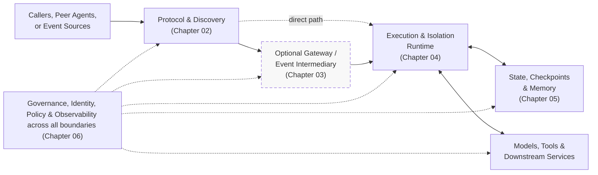

# 7. Reference architecture

Status: outline. Owner: Aman Singh (@amansinghoriginal).

This chapter will help platform teams connect the protocol, routing, runtime, state, and governance choices in chapters 02-06 into end-to-end systems. It will explain responsibilities and tradeoffs through use cases, rather than prescribe one framework or deployment topology.

This outline proposes the chapter structure and an initial example for review. Definitions, diagrams, decision tables, and worked patterns will be developed with the stream owners. Following the [charter](./charter.md), single-cluster deployment is the baseline; multi-cluster differences will be identified where relevant.

## 7.1 Shared terminology

Establish provisional working definitions to connect the stream chapters:

- **Agent definition vs. logical agent:** The code, configuration, and tool profile (definition) versus the named, addressable actor with a stable identity across runs (logical agent).
- **Task and run:** The caller-visible objective or unit of work (task) versus a single execution attempt or workflow instance that carries it out (run).
- **Protocol session vs. network connection:** The protocol-level association between caller and endpoint (where the protocol defines one; some interactions are stateless) versus an underlying TCP/HTTP/SSE transport connection.
- **Subscription and continuation state:** A registered interest in future events (subscription) versus the agent-owned record of why it subscribed and the instructions needed to handle later events (continuation state).
- **Operational state, checkpoint, and memory:** Active task/subscription records (operational state), saved progress used to recover an interrupted execution or environment (checkpoint/snapshot), and information retained or retrieved to inform current or future reasoning (memory).
- **Worker, Pod, and sandbox:** The process executing agent or tool logic (worker), the Kubernetes scheduling unit (Pod), and the isolation boundary constraining untrusted execution (sandbox).

These concepts do not map one-to-one: replacing a Pod or worker need not create a new logical agent, and reconnecting a stream does not by itself recover an interrupted run.

**[OPEN]** Align these provisional definitions with chapters 02, 04, and 05 before treating them as shared vocabulary.

## 7.2 Logical component roles

Map the responsibilities supplied by the stream chapters:

- [Protocol and communication](./02_Protocol_and_Communication_Interoperability.md): discovery, interfaces, identifiers, and interaction contracts.
- [Gateway and data plane](./03_Gateway_and_Data_Plane.md): routing and mediation where the use case requires them.
- [Runtime and container abstraction](./04_Runtime_and_Container_Abstraction.md): execution, placement, isolation, and lifecycle.
- [State, memory and persistence](./05_State_Memory_and_Persistence.md): ownership, persistence, retrieval, and recovery of the different state categories.
- [Governance, observability, security and policy](./06_Governance_Observability_Security_and_Policy.md): authority, enforcement, and evidence across the interactions.

The diagram shows how these logical roles connect without requiring a separate service or Pod for every role. Gateways, event intermediaries, and specialized hosting components appear only where the pattern needs them.

## 7.3 Architectural decision points

These are initial decision questions to examine across patterns, not recommended defaults:

| Dimension | Key choice or question | Why it matters |
| --- | --- | --- |
| **Interaction and delivery** | How do requests or events reach execution, and what delivery contract applies? | Receipt, replay, and execution completion are different boundaries. |
| **Execution and recovery** | What state carries forward, and which mechanism recovers progress? | Fresh execution, workflow recovery, and environment restoration can compose. |
| **State and context** | Who owns each state category, and what must remain durable or be refreshed? | Determines recovery, consistency, retention, and cleanup responsibilities. |
| **Placement and routing** | Where does execution run, and how is work routed when placement changes? | Worker replacement alone does not recover logical work. |
| **Authority and observation** | Whose permissions apply, where are they enforced, and what outcomes are recorded? | Authorization and dispatch are not proof that an external action completed. |

The [draft MCP Events proposal](https://github.com/modelcontextprotocol/modelcontextprotocol/pull/3415) is one protocol-level reference for event delivery; how an application turns delivery into agent work remains a separate decision.

## 7.4 Reference patterns

### Proposed first example: event-driven monitoring

An application or agent selects a condition to monitor and records what should happen when it changes. A later event can start a new run using saved instructions or notify an existing durable workflow, depending on the context and progress that must be preserved.

The worked example will connect event discovery and delivery with application-owned state, execution, authorization, and action outcomes. It will explain recovery, duplicate handling, and cancellation boundaries.

Public comparison inputs include [Knative Eventing](https://knative.dev/docs/eventing/) for event routing, [Temporal message passing](https://docs.temporal.io/encyclopedia/workflow-message-passing) for notifying an existing workflow, and the [Drasi router](https://github.com/drasi-project/drasi-platform/blob/71420bd77f5b829109b807a6cee0fd50a37667ae/reactions/dapr/agent-router/README.md) with the [Dapr Agents integration proposal](https://github.com/dapr/dapr-agents/pull/905) for starting event-handling runs from saved instructions. These illustrate different responsibilities and choices, not interchangeable complete stacks.

**[OPEN]** Confirm this first example and select additional, contrasting use cases from the stream contributions and [use-case submissions](./use-cases/TEMPLATE.md). The pattern catalogue is not fixed by this initial outline.

## 7.5 Cross-stream review and gap handoff

- Agree which shared terms and responsibilities belong here versus in the stream chapters.
- Identify reviewers for the first example's protocol, runtime, state, and governance assumptions.
- Decide the initial depth of multi-cluster coverage and the next patterns to develop.
- Distinguish proposed descriptive guidance from any requirements needing explicit group agreement.

Route evidenced gaps to [Chapter 08](./08_Gap_Analysis_and_Recommendations.md), with the affected use case and relevant upstream work. An implementation limitation or an intentionally application-owned responsibility is not automatically a missing standard.

