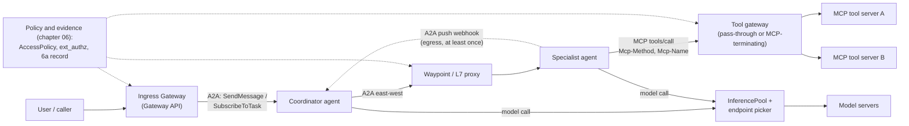
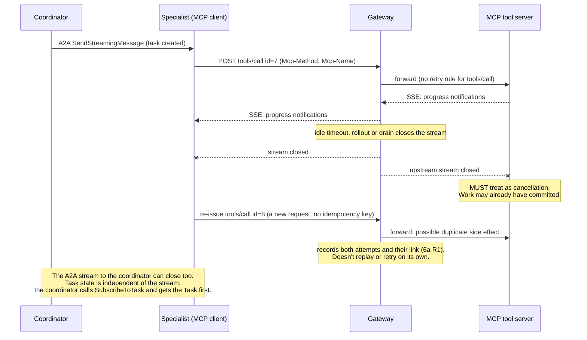
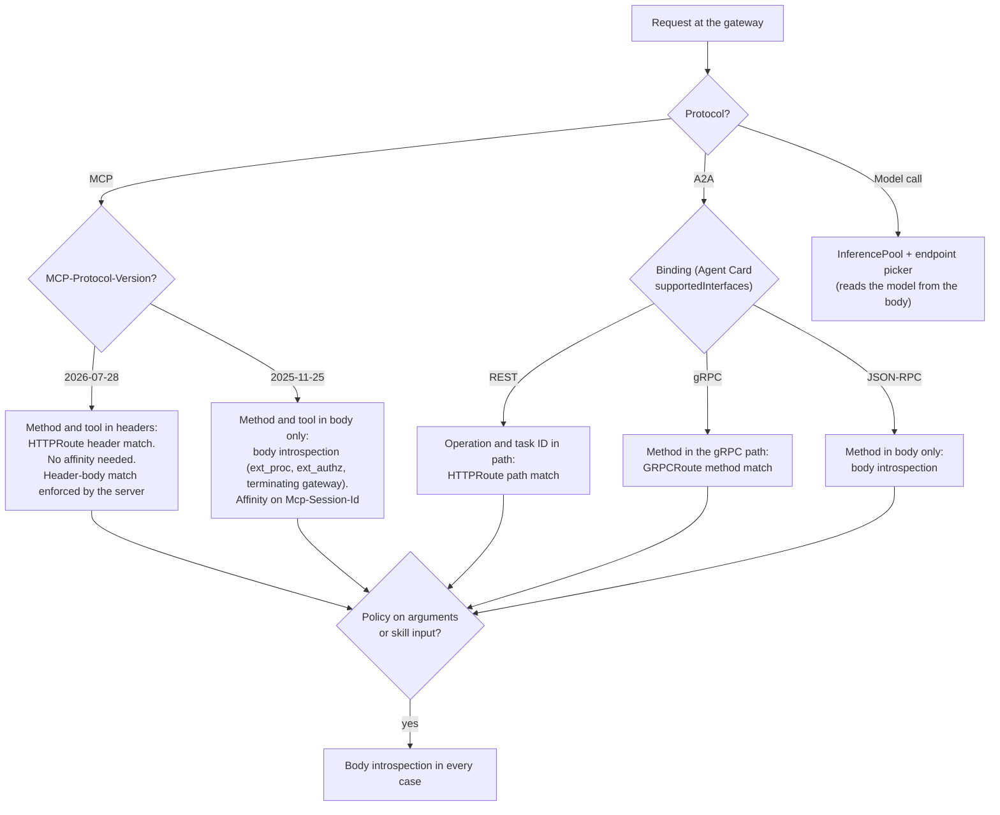

# Stream plan: gateway and data plane

Technical chapter: [Chapter 03](../03_Gateway_and_Data_Plane.md)
Stream owner: Akanksha Trehun (@magic-peach), as recorded in the [initiative README](../README.md#workstreams)
Team: Akanksha Trehun (@magic-peach), owner, confirmed; contributor seats open (see section 2)
Status: scoping
Last updated: 2026-11-27
Next walkthrough: December 3, 2026 session

## 1. Purpose and intended outcome

**The operational problem.** On Kubernetes, an agent sends three kinds of traffic through the same gateways and meshes:

- model calls (inference);
- tool calls over MCP;
- task delegation to other agents over A2A.

The Gateway API Inference Extension covers the first: an InferencePool, and an endpoint picker that chooses a model server from the request and server metrics. Nothing comparable covers the other two. Platform teams put MCP and A2A behind HTTPRoutes, sidecars or waypoints written for request-response microservices. They then find out at runtime:

- whether a proxy may retry a call;
- what a closed stream means;
- whether routing needs affinity;
- whether the proxy can see enough of the request to apply per-tool policy.

**This chapter helps** platform engineers, gateway and mesh implementers, and the Gateway API and agentic networking maintainers decide:

- which routing needs current Gateway API resources and the Inference Extension already cover, and which need a protocol-aware extension or an intermediary that terminates the protocol;
- what affinity, streaming and timeout behavior each protocol version requires of a proxy;
- what a gateway may and may not do when a connection or backend fails mid-task (retry, replay, close, drain), and what it should record;
- where per-tool and per-skill authorization can be enforced, from which request fields, and at what cost;
- whether the conformance behaviors fit an extension contract on Gateway API primitives, or need a new session-aware primitive (the chapter outline's open question).

**What differs from distributed systems generally:**

- *The same transport means different things.*
  - In MCP 2026-07-28, closing an SSE response stream "MUST be treated by the server as cancellation".
  - In A2A 1.0, a task's lifecycle "is independent of any individual stream's lifecycle" (§3.5.2).
  - So a gateway's idle timeout, rollout or drain cancels work under one protocol and is harmless under the other.
- *Retry safety is in the payload, not the HTTP method.* Every MCP call is a POST. `tools/list` is safe to retry; a side-effecting `tools/call` is not. MCP has no idempotency key, and tool annotations such as `idempotentHint` are untrusted hints.
- *The fields policy needs move between versions and bindings.*
  - MCP 2026-07-28 mirrors the method and tool name into headers; 2025-11-25 does not.
  - A2A's REST binding puts the operation and task ID in the URL path, its gRPC binding in the gRPC method, and its JSON-RPC binding only in the body.
- *Long-lived interactions outlive the connections that carry them.* Examples are MCP tasks, A2A tasks, `subscriptions/listen` streams and MRTR round-trips. The gateway sees many short exchanges about one piece of work.
- *Credentials can't be forwarded.* MCP servers "MUST NOT accept or transit any other tokens", and tokens are audience-bound (RFC 8707). A gateway that aggregates tool servers is a client to each of them, not a pass-through.

**Minimum useful outcome for v0.1**, within about 1.5 pages:

1. A routing responsibility table with pinned versions. It covers each need (route, authorize, retry, affinity, stream handling, aggregation, inference) and what covers it:
   - Gateway API v1.7.0 Standard or Experimental;
   - the Inference Extension;
   - an extension point (external authorization, external processing);
   - kube-agentic-networking;
   - an intermediary that terminates the protocol.
2. Three gateway patterns, each with failure behavior:
   - pass-through L7;
   - MCP-terminating (aggregating) gateway;
   - east-west waypoint for A2A.
3. A disconnect walkthrough on the shared reference scenario: a stream breaks mid tool call, and a gateway rollout happens during a long task.
4. An evidence-backed answer, or an explicit deferral, on the open question (extension contract or new primitive), and a short list of gaps for chapter 08.

The chapter does not choose a proxy product or design a protocol. It describes what the specifications require of an intermediary, what Kubernetes networking APIs already provide, and where the two don't meet.

## 2. Team and expertise

| Person / handle | Expertise / perspective | Intended contribution | Participation |
|---|---|---|---|
| Akanksha Trehun (@magic-peach) | Gateway API, MCP and A2A transports, proxy behavior | Owner; scope, routing table, patterns, disconnect walkthrough, drafting, coordination | Confirmed |
| Open seat | Gateway API or Inference Extension implementation (an implementer or maintainer) | Check the Gateway API columns of the routing table; session persistence, retries, timeouts, external processing | Open |
| Open seat | Service mesh, waypoint or east-west L7 proxy operations | Pattern 3 (A2A through a waypoint); drain and stream-timeout behavior | Open |
| Open seat | MCP or A2A gateway in production (an operator) | Practitioner review of the patterns and failure behavior; a use case through the [use-case template](../use-cases/TEMPLATE.md) | Open |
| Open seat | kube-agentic-networking or AI gateway work | Mapping `AccessPolicy` and `XBackend` onto the table; upstream liaison | Open |

- **Missing expertise or perspectives:**
  - a Gateway API or Inference Extension implementer;
  - someone who runs MCP or A2A behind a gateway in production;
  - mesh or waypoint operators;
  - an upstream contact in kube-agentic-networking (SIG Network).
- **Cross-stream reviewers:**
  - protocol (Moeez Khan) for what each specification says about streams and headers;
  - runtime for Pod and proxy termination;
  - state for task stores and deduplication;
  - governance, including 6a (Sankalp Gilda), for enforcement points and the per-call record.
- **Recruitment action** (proposed for the owner):
  - post a call in `#initiative-distributed-agentic-systems` with one first task per seat;
  - approach the contributor register's gateway volunteers and the kube-agentic-networking community meeting.
  - Checkpoint: contributors named by the December 17 session.
- **How to join:** reply in `#initiative-distributed-agentic-systems`, or comment on this plan's pull request with the area you would like to take.
- **First task for a new contributor** (about an hour, in the working document):
  - take one row of the routing responsibility table, for example "retry policy for `tools/call`";
  - fill each column from the primary source (Gateway API release, GEP or API type; specification section);
  - record what you couldn't confirm.

Only people who have agreed are listed, by GitHub handle.

## 3. Scope and priority questions

- **In scope:**
  - north-south and east-west routing of MCP, A2A and model traffic;
  - how inference routing fits alongside agent and tool routing;
  - affinity and session persistence;
  - streaming (SSE, gRPC streams) through proxies: buffering, idle and request timeouts, keep-alive;
  - retry and timeout policy per protocol method;
  - drain and rollout behavior for long-lived streams;
  - where policy is enforced and which request fields it can read (headers, path, body);
  - aggregating and multiplexing several tool servers behind one endpoint;
  - push-notification (webhook) egress;
  - the conformance behaviors for the open question.
- **Out of scope:**
  - choosing a proxy, gateway or mesh product;
  - treating a new gateway primitive as agreed;
  - inference scheduling internals (endpoint picker plugins, disaggregated serving), which belong to the Inference Extension and llm-d;
  - authorization policy content and the evidence record (chapter 06);
  - protocol design.
- **Assumptions and terminology:**
  - The chapter separates an *inference request*, a *tool call* (MCP), a *delegated task* (A2A), a *stream* (one SSE or gRPC response that may stay open), a *long-running operation* (an MCP task or A2A task, addressed by ID across many requests), and a *network connection*.
  - "Session" is used only for MCP 2025-11-25's protocol session (`Mcp-Session-Id`) and for Gateway API's session persistence. MCP 2026-07-28 has no protocol session.
  - Terms are to be aligned with chapter 07's "protocol session vs. network connection".
- **Single-cluster baseline:**
  - a Gateway API implementation for ingress, and optionally a mesh or waypoint for east-west traffic;
  - agents, tool servers and model servers as Services in one cluster, on MCP Streamable HTTP and A2A over HTTP or gRPC.
- **Multi-cluster, edge, or disconnected considerations** (later investigations):
  - cross-cluster routing of long-running operations (the task ID refers to state in one cluster);
  - InferencePoolImport for model traffic across clusters;
  - webhook egress across trust domains;
  - control-plane reachability during failover.
- **Boundaries with other streams** (proposed leads, to agree with each owner):
  - *Protocol (chapter 02):* protocol states what each specification says about streams, sessions, headers, reconnection and errors. Gateway leads on routing, affinity, retries, timeouts, drain and proxy behavior. The removal of `Mcp-Session-Id` in MCP 2026-07-28, and the new `Mcp-Method` and `Mcp-Name` headers, affect both; this plan rewrites the chapter 03 session-pinning line (see section 7).
  - *Runtime (chapter 04):* runtime leads on agent and tool Pod termination and graceful shutdown. Gateway leads on proxy drain, and on the effect of proxy and backend restarts on in-flight streams.
  - *State (chapter 05):* state leads on durable task stores, deduplication and checkpoints. Gateway covers why routing shouldn't carry that state (no affinity for task IDs), and what it needs from a shared store.
  - *Governance (chapter 06):* governance leads on identity, token exchange, authorization policy and the 6a record. Gateway covers where enforcement runs (header, path or body; request or response phase) and what the gateway can observe for the record. The 6a response-phase note in chapter 03 stays, as an input to the open question.
  - *Reference architecture (chapter 07):* receives the gateway component roles, the three patterns and the disconnect flows.

| Priority | Question to answer | Intended output | Contributor |
|---|---|---|---|
| v0.1 | Which routing needs do Gateway API v1.7.0 and the Inference Extension cover today, and which need an extension or a protocol-terminating intermediary? | Routing responsibility table with pinned versions | Akanksha; help needed (Gateway API implementer) |
| v0.1 | What affinity, streaming and timeout behavior do MCP (2026-07-28 and 2025-11-25) and A2A 1.0 require of a proxy, per binding? | Transport and affinity guidance per protocol version and binding | Akanksha; review by protocol (Moeez) |
| v0.1 | What may a gateway do when a stream, a backend or the gateway itself fails mid-task: retry, replay, close, drain? What should it record? | Disconnect and rollout walkthrough on the shared scenario | Akanksha; review by state and governance |
| v0.1 | Where can per-tool and per-skill authorization run, from which fields, and what does each placement cost? | Enforcement-point comparison (header, path, body; extension, policy API, terminating gateway) | Help needed (kube-agentic-networking contact) |
| v0.1 | Do the conformance behaviors fit an extension contract on Gateway API primitives, or is a new session-aware primitive needed? | Evidence for the open question; gaps for chapter 08 | All |
| Later | How are long-running operations routed across clusters, and what happens to a task ID when its cluster fails over? | Investigation | Help needed |
| Later | How does an MCP-terminating gateway keep an aggregated tool list fresh (`ttlMs`, `cacheScope`, `listChanged`) across many upstreams? | Pattern detail | Help needed |

## 4. Starting knowledge and sources

| Source / project | Relevant section or capability | Why it matters / question informed | Version / date and evidence limitations |
|---|---|---|---|
| [Cloud Native Agentic Standards](https://www.cncf.io/blog/2026/03/23/cloud-native-agentic-standards/) | Inference availability; control and communication | Baseline to reference, not restate | Published March 23, 2026; assesses inference traffic, so agent and tool traffic are assessed here separately |
| [MCP specification](https://modelcontextprotocol.io/specification/2026-07-28), Streamable HTTP transport | Stateless requests; `Mcp-Method` and `Mcp-Name` headers with header-body validation (`HeaderMismatch`, -32020); GET stream removed in favour of `subscriptions/listen`; no `Last-Event-ID` resumability; closed stream means cancellation; SSE keep-alive comments and `X-Accel-Buffering: no` | Affinity, header-based routing and policy, stream handling, retry safety | Revision 2026-07-28; documented. Many deployed servers still speak 2025-11-25 (sessions, GET stream, resumability), so both are recorded |
| MCP [Multi Round-Trip Requests](https://modelcontextprotocol.io/specification/2026-07-28/basic/patterns/mrtr) and [Tasks extension](https://modelcontextprotocol.io/specification/2026-07-28/extensions/tasks/overview) | `input_required` with opaque `requestState`, retried with a new ID; `tasks/get` polling, "durably created" tasks | Whether routing needs affinity for server-to-client requests and long work | 2026-07-28; documented. `tasks/get` has no task-ID header, so a task can be routed by ID only by parsing the body (inferred) |
| MCP [authorization](https://modelcontextprotocol.io/specification/2026-07-28/basic/authorization) | Token passthrough forbidden; audience validation; RFC 8707 resource indicators | What an aggregating gateway must do for upstream credentials | 2026-07-28; documented. Enforcement and token exchange lead: chapter 06 |
| [A2A specification](https://a2a-protocol.org/latest/specification/) | Three bindings (JSON-RPC, gRPC, HTTP+JSON/REST; §5.3 method mapping); `A2A-Version` and `A2A-Extensions` as headers (§3.2.6); Subscribe to Task returns the Task first, and streams are independent of the task (§3.1.6, §3.5.2); push notifications at least once, duplicates possible (§4.3); Agent Card caching with `Cache-Control` and `ETag` (§8.6); Send Message "MAY be idempotent" (§3.3.1) | Routability per binding, reconnect behavior, webhook egress, retry safety | 1.0 (v1.0.1, May 28, 2026); documented |
| [Gateway API](https://gateway-api.sigs.k8s.io/) | HTTPRoute matching and timeouts (Standard); HTTPRoute retries promoted to Standard in v1.7.0 (GEP-1731); session persistence, Cookie or Header (GEP-1619), Experimental and configured on `XBackend` in v1.7.0; ExternalAuth filter Experimental; GRPCRoute; pre-routing listener filters (GEP-5224, Experimental) | Which rows of the table existing resources cover | v1.7.0, October 29, 2026; documented. Implementation conformance varies, and no current API matches on request-body fields |
| [Gateway API Inference Extension](https://gateway-api-inference-extension.sigs.k8s.io/) | InferencePool (v1), InferencePoolImport (v1alpha1), lightweight endpoint picker, conformance tests | The model-traffic column, and how it fits alongside agent routing | v1.6.2, September 17, 2026. The endpoint picker, InferenceObjective and body-based router moved to llm-d (llm-d-router, llm-d-inference-payload-processor) |
| [kube-agentic-networking](https://github.com/kubernetes-sigs/kube-agentic-networking) (SIG Network) | `AccessPolicy` (v1alpha1): Allow or ExternalAuth on a Gateway, SPIFFE or ServiceAccount sources, MCP method and tool-name rules, CEL; `XBackend` (v0alpha0) for MCP backends; Envoy-based reference implementation and conformance suite | The upstream Kubernetes API for agent-tool authorization; enforcement-point question | v0.2.0, September 1, 2026; documented. Its MCP base-method list still names 2025-11-25 constructs (`initialize`, the SSE GET stream, DELETE with `mcp-session-id`). Tool matching uses `params.name` only; `params.uri` is not yet implemented |
| Implementations to examine, not endorsements: [agentgateway](https://github.com/agentgateway/agentgateway), [Envoy AI Gateway](https://github.com/envoyproxy/ai-gateway), Istio ambient waypoints | MCP and A2A routing, tool aggregation and filtering, per-tool policy, waypoint L7 for east-west traffic | Evidence for patterns 1 to 3 and for what implementations add beyond Gateway API | agentgateway v1.7.0, October 27, 2026; Envoy AI Gateway v1.3.0, November 18, 2026; not yet reviewed in depth. Which MCP revision each supports is to verify |
| [Chapter 03 outline](../03_Gateway_and_Data_Plane.md) | Framing and open question; 6a response-phase note (#2369) | Hypotheses to test, not conclusions | Framing written against MCP 2025-11-25 (see section 7) |
| [Kubeflow agentic RAG write-up](https://github.com/cncf/endusers/issues/2114) | MCP tools and A2A routing behind a gateway on Kubernetes | Practitioner evidence for placement | Documented by its authors as deployed; not verified by this stream |

- **Which Agentic Standards recommendations apply, and what are we adding?** The Standards cover inference availability and communication. This chapter adds:
  - the agent and tool traffic classes;
  - per-protocol, per-version proxy behavior (affinity, retries, streams, drain);
  - the mapping onto Gateway API resources and their channels.
- **What do Kubernetes and existing projects already provide?**
  - Route matching on host, path, header and gRPC method; timeouts; retries (Standard from v1.7.0).
  - Header or cookie session persistence (Experimental).
  - External authorization (Experimental filter) and external processing (implementation-specific).
  - Inference routing; and in kube-agentic-networking, MCP method and tool authorization.
  - Still uncertain:
    - body-field routing and policy as a portable API;
    - retry policy keyed on protocol method;
    - standard drain behavior for long-lived streams;
    - support for MCP 2026-07-28 across implementations.
- **Where do sources disagree or lag?**
  - The chapter 03 outline and kube-agentic-networking's base-method list assume MCP 2025-11-25 sessions.
  - The Inference Extension docs still describe components that have moved to llm-d.
  - "Session" means a protocol association in MCP 2025-11-25, and backend affinity in Gateway API.
- **Upstream contacts to approach:**
  - Gateway API and GEP-1619 maintainers;
  - kube-agentic-networking maintainers;
  - MCP transport maintainers;
  - A2A maintainers for binding questions.

## 5. Milestones and substantive work

Targets below are the owner's own. Contributor targets are agreed with them before they are added.

| Milestone / output | Responsible contributor(s) | Target checkpoint | Status | Issue / PR |
|---|---|---|---|---|
| Initial scope and team plan | Akanksha Trehun | December 3, 2026 session | In review | This pull request |
| Routing responsibility table and the version note for the chapter 03 framing | Akanksha Trehun; reviewers to agree | Table reviewed December 17, 2026 | In progress | Working document tab; issue to create after December 3 |
| Disconnect and rollout walkthrough on the shared scenario | Akanksha Trehun; review by protocol, state, governance | December 17, 2026 | Planned | Issue to create after December 3 |
| First useful chapter draft (patterns, table, walkthrough) | Akanksha Trehun; contributors to agree | January 14, 2027 session | Planned | PR to chapter 03 |
| Architecture and gap-analysis inputs | Akanksha Trehun; with chapter 07 (Aman Singh) and the chapter 08 owner, to agree | January 28, 2027 | Planned | Not yet created |
| Cross-stream review and integration | Akanksha Trehun; affected stream owners | February 2027 sessions; chapter final before the v0.1 release review, ahead of KubeCon + CloudNativeCon Europe, March 2027 | Planned | Not yet created |

Drafting through December happens in a tab of the [working document](https://docs.google.com/document/d/1bRWy8vhke16mMhpPlEE_Dv71fTmkRWG-4Cy1hdTHUb0/edit), so contributors can comment freely. The reviewed result moves into the chapter file by pull request from January.

## 6. Current biweekly walkthrough: December 3, 2026

- **What changed or did we learn?**
  - Against MCP 2026-07-28, the chapter 03 framing changes:
    - session pinning applies only to 2025-11-25 servers;
    - server-initiated push no longer needs a standalone stream, since every stream is the response to a client POST and server-to-client requests use MRTR;
    - method and tool name are in headers.
  - MCP and A2A treat a closed stream in opposite ways.
  - kube-agentic-networking's MCP base-method list predates 2026-07-28.
  - Each of these comes from documents only.
- **What concrete material can we walk through?** The three diagrams below: where the gateway sits, the disconnect sequence, and the routing decision by protocol version and binding.
- **Which recommendation, assumption, or boundary needs feedback?**
  - Should the gateway ever retry `tools/call`? The proposal is never by default; retries only for list, read and discovery methods, and connection failures before the request is sent.
  - Should chapter 03 cover MCP 2025-11-25 beyond version notes, given how many servers still use it?
  - Is aggregation (pattern 2) in v0.1 scope, or deferred with token exchange to chapter 06?
  - Is the boundary with chapter 02 right, as written in section 3 and in chapter 02's table?
- **What is blocked, and what help is needed?** Contributors for the open seats, especially a Gateway API implementer and a production operator.
- **What will we bring to the next meeting?** The routing table reviewed by at least one Gateway API contributor (owner; December 17).
- **Related issues, PRs, or meeting notes:**
  - [creation issue #1746](https://github.com/cncf/toc/issues/1746);
  - [protocol stream plan, #2370](https://github.com/cncf/toc/pull/2370);
  - [6a outline and chapter 03 note, #2369](https://github.com/cncf/toc/pull/2369);
  - [chapter 07 skeleton, #2367](https://github.com/cncf/toc/pull/2367).

### Diagram 1: traffic classes and where the gateway sits (single cluster)

### Diagram 2: a broken stream during a tool call, MCP 2026-07-28

### Diagram 3: what the gateway can see, by protocol version and binding

## 7. Findings and integration: develop progressively

No findings are established yet. The rows below are candidate investigations drawn from specification and API text. None has been demonstrated or reviewed.

| Finding / pattern / open gap | Evidence and limitations | Related streams / coordination needed | Destination / next action |
|---|---|---|---|
| The chapter 03 framing is version-dependent: session pinning, the push concern and the need for body introspection hold for MCP 2025-11-25, not 2026-07-28 | MCP 2026-07-28 changelog (sessions removed, GET stream replaced by `subscriptions/listen`, MRTR); Streamable HTTP "Standard Request Headers"; documented only | Protocol (agree wording) | Replace the outline's framing bullet (proposed text below) |
| Closing a stream cancels an MCP request but not an A2A task, so gateway timeouts, rollouts and drains need per-protocol guidance | MCP Streamable HTTP, Cancellation; A2A §3.5.2; documented only | Runtime (termination), state | Disconnect walkthrough; candidate chapter 08 gap: no standard drain behavior for long-lived streams (to verify against Gateway API and implementations) |
| A gateway can't tell a safe MCP retry from an unsafe one by HTTP method; it can by the `Mcp-Method` header (2026-07-28 only) | All MCP calls are POST; no idempotency key; `idempotentHint` is an untrusted hint; HTTPRoute retry is Standard in v1.7.0; documented only | Protocol, state (deduplication), governance (6a R1 attempt identity) | Guidance: a rule matching `Mcp-Method: tools/call` with no retry. Shared chapter 08 gap with chapter 02: no idempotency key |
| What policy can see depends on protocol version and binding | MCP header mirroring; A2A §5.3 method mapping (REST path, gRPC method, JSON-RPC body); no Gateway API match on body fields; documented only | Governance (enforcement) | Enforcement-point comparison; candidate chapter 08 gap: no portable body-field match (Gateway API, kube-agentic-networking) |
| Long-running operations need a shared store, not gateway affinity | MCP tasks "durably created", `tasks/get` has no task-ID header; A2A Subscribe to Task returns the current Task first; MRTR `requestState` is designed to avoid stateful load balancing; documented and partly inferred | State (lead) | Pattern guidance; confirm with the state owner |
| An aggregating MCP gateway is a client to each upstream, not a forwarder | MCP authorization: no token passthrough, audience validation, RFC 8707; documented only | Governance (token exchange) | Pattern 2 failure and trust notes |
| kube-agentic-networking `AccessPolicy` assumes MCP 2025-11-25 base methods and matches only `params.name` | `api/v1alpha1/accesspolicy_types.go`, v0.2.0; documented only | Governance | Raise upstream with evidence; don't record as a gap until maintainers respond |
| Session persistence is Experimental and moved to `XBackend` in v1.7.0; it's needed only for MCP 2025-11-25 | Gateway API v1.7.0 release notes; GEP-1619; documented only | None | Probably guidance, not a gap; confirm |
| Push notifications are webhook egress from the agent, at least once and possibly duplicated | A2A §3.5.1, §4.3; documented only | Governance (egress policy), state (idempotent processing) | Pattern 3 note |

**Proposed replacement for the chapter 03 framing bullet** (to agree with the protocol owner): "The waypoint-style, sidecarless L7 architecture transfers to agent traffic, and what the proxy must understand depends on protocol version and binding. With MCP 2026-07-28, the method and tool name are in headers, servers reject a header that doesn't match the body, and no affinity is needed. With MCP 2025-11-25, affinity keys on `Mcp-Session-Id`, and policy needs JSON-RPC body introspection. Argument-level policy needs the body in both. A closed stream cancels an MCP request but not an A2A task, so retry, timeout and drain policy is set per protocol."

For each substantive pattern, the chapter uses: Problem, Context, Approach, Alternatives and trade-offs, Failure behavior, Evidence, Related streams. The three patterns to develop:

1. **Pass-through L7 gateway (agent to tool).** It routes, authenticates and rate-limits on host, path and the MCP headers, and the tool server authorizes.
   - Failure behavior: it doesn't retry `tools/call`, passes SSE through unbuffered, and sets timeouts above the server's keep-alive interval.
   - Limits: no argument policy and no aggregation.
2. **MCP-terminating gateway (aggregating).** It presents one MCP server built from several upstreams, filters and renames tools, authorizes per tool and per argument, and gets its own upstream tokens.
   - Failure behavior: it is in the path of every tool call. It must not retry side-effecting calls, and must keep the aggregated list fresh.
   - Trust: it now holds credentials (chapter 06).
3. **East-west waypoint for A2A.** A per-namespace or per-service L7 proxy carries identity, tracing and policy on each hop. Routing depends on the binding (REST path, gRPC method, or JSON-RPC body).
   - Failure behavior: a closed stream is recovered with Subscribe to Task.
   - Push notifications leave as egress and need their own policy.

### Reference architecture handoff

Proposed input to [chapter 07](../07_Reference_Architecture.md):

- **Component roles:** ingress gateway, east-west waypoint, tool gateway (pass-through or terminating), inference pool and endpoint picker, webhook egress.
- **Interfaces:** the headers, paths and gRPC methods each role reads.
- **Flows:** diagrams 1 to 3.
- **Decision points:** pass-through or terminating; retry rules per method; affinity only for 2025-11-25; drain timeouts against the longest expected tool call; tasks extension for long work.

The diagram 1 roles are to be mapped onto chapter 07's "optional gateway / event intermediary" node, and chapter 07's "protocol session vs. network connection" term aligned with MCP 2026-07-28. To review with Aman Singh.

### Gap-analysis handoff

None proposed yet. The candidates above go to [chapter 08](../08_Gap_Analysis_and_Recommendations.md) only with evidence, the existing capability and its limitation, the gap type, and a suggested upstream destination, without implying acceptance. Gap types are documentation, implementation, interoperability or specification. Upstream destinations are, for example, Gateway API GEPs, kube-agentic-networking, or the MCP transport working group.

The open question is answered from these rows. Today's documents suggest an extension contract on existing primitives for MCP 2026-07-28, with the question kept open for mixed-version fleets and body-field policy. The conformance behaviors to test whichever way it goes:

- header-body consistency where the gateway enforces on headers;
- no gateway retry of non-idempotent methods;
- unbuffered streams;
- drain on rollout;
- the 6a response-phase check on JSON-RPC error completions as well as results.

## 8. Review and readiness: use later

Uses the [common readiness checklist](./TEMPLATE.md#8-review-and-readiness--use-later). No items are checked; this plan has not been reviewed.
